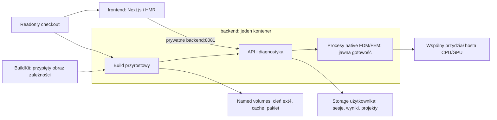

# Przegląd audytu Docker DEV — uproszczenie ścieżki uruchamiania

Data: 21.10.2026. Aktualizacja: po commicie budżetu H0. Stan źródeł: master
`9eb42f41c964d3e3adcdd5e6c3430b29dd283a88`; ostatni wykonany build pochodzi
z `73e275ce1de772ea306714574a1be374cc4449df`. H0 nie jest jeszcze zbudowane
ani zastosowane do runtime. Poniższe starsze obserwacje zachowano chronologicznie;
aktualna blokada jest opisana w sekcji „Uzupełnienie: rzeczywisty restart”.
Przeczytano cały `2026-10-21-docker-dev-workflow-audit.md` i zweryfikowano
bezpośrednio niżej wymienione mechanizmy. Bez testów. Nie powtarzano pełnego
zliczania LOC ani historii commitów. Bieżąca inspekcja Dockera objęła mastera
oraz dwie grupy współdzielące ledger, bez zmiany ich procesów lub danych.

## Wniosek i schemat kontenerów

Główny wniosek audytu jest uzasadniony: codzienny start ma zbyt wiele zależności
od recovery i identyfikacji buildu. Istotny problem leży w orkiestracji oraz
sprzężeniu stanu buildu ze stanem symulacji. Dodawanie kolejnych stałych usług
nie usuwa tego sprzężenia.

Docelowo zachować dwie stałe usługi tej samej grupy checkoutu:

- **backend**: trwały cache i cień źródeł w named volumes, przyrostowy build
  aplikacji, następnie API/native runtime; jeden właściciel procesu i jeden
  koordynator start/stop;
- **frontend**: ten sam readonly checkout, Next/HMR, osobne named volumes
  zależności i `.next`, połączenie z prywatnym `backend:8081`.

Obraz przypiętych zależności nadal przygotowuje BuildKit. Nie dodawać osobnej
usługi `backend-build`. Sesje, wyniki i projekty zachować na skonfigurowanym
storage użytkownika. Kwalifikacja/release może korzystać z pełnej zamrożonej
ścieżki dowodowej; codzienny DEV powinien mieć prostszy cykl bez ręcznych pinów.
To rekomendacja architektury, nie deklaracja wdrożonej migracji.

## Co potwierdzono i co wymaga korekty w audycie

| Wniosek | Ocena na bieżących źródłach |
|---|---|
| Capture dwukrotnie odczytuje checkout i kończy start przy różnicy | Potwierdzone: `backend_source.py::capture_live_source_manifest`, linie 1664–1667. To bezpośrednia przyczyna ostatniego exit 2 |
| Readonly Git z `autocrlf=true` i `GIT_OPTIONAL_LOCKS=0` | Potwierdzone: `backend_source.py::_live_git_command` i `_live_run_git`. Czasy statusu pochodzą z wcześniejszych logów, nie z nowego benchmarku |
| Snapshot jest wejściem kompilacji | Potwierdzone m.in. przez `fullmag-build-info/build.rs:12` oraz przekazanie tożsamości do CMake FEM. Koszt relinkowania należy mierzyć po zmianie, nie zakładać stałej liczby sekund |
| Kandydat po przerwanym buildzie blokuje start | Potwierdzone: `backend_dev.py` odrzuca niepustego kandydata o stanie innym niż ready (okolice linii 3444) |
| Globalny limit 64 prób na fazę | Warunek jest w `docker_build_control.py:508`. Przycinania nie potwierdzono; to problem projektu retencji, nie uzasadnienie skasowania historii |
| Nadzór ma 30 s tolerancji | Potwierdzone: `runtime_service.py:89`. Sam timeout obserwacji nie dowodzi śmierci API ani solvera |
| Commit 72cd5efcd ustawia Cargo tylko na 4 | Wymaga doprecyzowania: 4 jest bazą Compose dla quota 4 CPU; `apply_saved_budget` ustawia w tej grupie **16**, zgodnie z profilem 128 GiB / 16 CPU. Odczyt środowiska działającego Cargo potwierdził 16; nowy Make zakończył się exit 0 |
| Usunięcie retencji z krytycznej ścieżki nie jest wykonane | Usunięcie synchronicznego wywołania było już w commicie 01cb8ed1; stary uruchomiony obraz go nie zawierał. Źródło i obraz trzeba odróżniać |
| Status pięciu grup oraz liczba wolumenów | To snapshot z czasu audytu; nie traktować go jako stale aktualnego stanu hosta |
| Zyski 1,5–2×, 3–4× i pętla poniżej 2 minut | Hipotezy do pomiaru, nie wyniki. Czas buildu może dominować I/O, nvcc, linkowanie albo zależności sekwencyjne |

Pierwsza próba `recreate-volume` z `72cd5efcd` skończyła się przed zmianą usług:
`pre-admission recreation cannot replace native recovery authority`.
Przyczyną jest skierowanie już uwierzytelnionego `PreApiContext` do wzajemnie
wykluczającej się ścieżki wymagającej pustego native recovery context.
Poprawka dotyczy istniejącego wyboru gałęzi, bez nowego modułu recovery,
resetu ownera ani ponownego Solve.
Po poprawce gałęzi recreate zakończyło się powodzeniem; późniejszy build
przeszedł. Nadal nie ma dowodu gotowości API ani meshu.

## Rekomendacje, których nie wdrażać dosłownie

1. **R0.4 — nie kontynuować po niespójnym capture z fałszywym manifestem.**
   Uprościć kopiowanie: zmaterializować wejście w ext4 i identyfikować rzeczywiste
   bajty użyte do kompilacji. Zmiana live checkoutu po przygotowaniu tej kopii
   nie powinna unieważniać rozpoczętego buildu; następny build obejmie nowe
   zmiany. Samo usunięcie porównania dwóch manifestów nie zapewnia tego kontraktu.
2. **R0.3 — przenieść tożsamość do runtime jako spójną migrację.**
   Usunięcie `rerun-if-env-changed` przy pozostawieniu wartości wbudowanej
   w binaria może raportować stary commit dla nowych bibliotek. Trzeba
   równocześnie zmienić producenta i konsumentów, w tym API↔CLI, i oddzielić
   tożsamość artefaktu od tożsamości bieżącej sesji.
3. **R0.9/R2.8 — kwarantanna niedokończonego kandydata zamiast kasowania.**
   Zachować ostatni opublikowany pakiet, log błędu i wymagane dane rollback.
   Automatyczne usunięcie kandydata lub wszystkich starych backupów nie wynika
   z obecnej zgody i nie dowodzi ich zbędności.
4. **R2.3/R2.5 — martwy PID albo kontener nie wystarcza do wyczyszczenia
   globalnego ledgera lub unknown activation.** Zwolnienie musi dotyczyć
   dokładnie jego runu/lease i nie może naruszać obcej grupy. Jedna przyjazna
   komenda może automatycznie odkrywać te dane; operator nie powinien ręcznie
   przepisywać UUID/SHA. Nie musi to oznaczać resetowania ownerów.
5. **R1.6 — współdzielić pobrania, zachować rozdział niezgodnych natywnych
   artefaktów.** Cargo registry i pnpm store są dobrymi kandydatami na wspólne
   named volumes. Usunięcie toolchainu z klucza natywnego CMake/target bez
   zastępczej walidacji ABI i zależności MFEM/CUDA może użyć starej biblioteki.
6. **R1.3 — zakaz testów nadal obowiązuje.** Audyt nie jest jego odwołaniem.
   Również reset danych, przeniesienie checkoutu do WSL i usunięcie starych
   tras nie zostały wykonane na podstawie tego przeglądu.
7. **R2.10 — limit CPU kontenera nie zastępuje delegacji workerów w obecnym
   runtime.** `accepted_fem_preparation_supervisor.rs:233` oraz
   `accepted_study_supervisor.rs:614` wywołują
   `LinuxWorkerCgroup::prepare(allocated_cpu_millis)` przed startem procesu.
   `worker_cgroup.rs:52` wymaga delegowanego rootu, a następnie egzekwuje budżet
   konkretnego workera. Samo usunięcie helpera/bramki ponownie zablokuje launch.
   Uproszczenie wymaga zmiany także tych konsumentów i zachowania limitów,
   identyfikacji oraz zakończenia całego drzewa workera.
8. **R1.1 — przebudowa w działającym backendzie potrzebuje bezpiecznej
   publikacji.** Supervisor może przełączać API na nowy pakiet dopiero po
   zakończeniu lub jawnym przerwaniu aktywnego runu. Nie nadpisywać bibliotek
   pod procesem solvera. Komenda użytkownika może ukrywać szczegóły; jeden
   właściciel procesu i zachowanie starego pakietu pozostają potrzebne.

## Kolejność zmian

1. Domknąć obecny start bez zmiany sesji: poprawny dispatch, log rzeczywistej
   fazy i Cargo 16, API ready, materializacja i mesh dla held04.
2. Usprawnić DEV capture/cache: jeden rzeczywisty zestaw wejść ext4, klucz
   backendu obejmujący jego wejścia; docs i frontend nie uruchamiają backend
   package pipeline. Osobno rozwiązać cache-hit i ujawnienie nowych plików.
3. Zrobić jeden publiczny interfejs lifecycle: up/status/logs/down/rebuild.
   Przerwanie obserwacji oddzielić od przerwania buildu. Wykryte przerwanie
   symulacji pokazać jako interrupted/held, bez automatycznego Solve.
4. Uporządkować aktualizację konfiguracji i zależności frontendu w zachowanym
   wolumenie; HMR skrócić po pomiarze kosztu pollingu na NTFS.
5. Dopiero po rzeczywistym cyklu edit→build→run usunąć zastąpione moduły oraz
   ujednolicić dokumentację. Ustalić jedną oficjalną drogę DEV, zachowując
   osobne wymagania kwalifikacji/release.

Miara powodzenia to czas edycja→API oraz skuteczny restart z zachowanymi
wynikami i cache, nie sama redukcja liczby linii. Ostatni build przeszedł;
API/mesh/Solve pozostają **NOT VERIFIED**. Nie wykonano testów,
resetu danych, globalnego prune ani migracji storage.

## Pomiar po przeglądzie i granice diagnozy

Nowy backend wystartował 23:14:06 UTC. Odczyt działającego Cargo potwierdził
16 jobów; Docker 128 GiB / 16 CPU. Capture 295448 ms, sync 17199 ms,
9183 pliki. Git status zajmował 109175 i 91096 ms.
Przerwa zapisów została zwolniona dopiero po przygotowaniu kopii ext4.

Wynik nowej próby: Make exit0 / 218431 ms, pakiet i gates PASS. Następnie
`runtime initialize-docker-accepted-store` przekroczył 180 s przed startem API.
Backend exited1/non-OOM, frontend healthy3198. Development
`8bad15a80b074dc1ac771433000bfb3b` jest failed-confirmed. Nie ponowiono bootstrapu,
aktywacji ani Solve. Porównanie Make 218431 ms z poprzednim 217249 ms nie jest
benchmarkiem jobów: źródła i warunki cache były różne.

### Diagnostyka przed main, bez otwierania SessionStore

W zarządzanych helperach tej samej grupy użyto tego samego obrazu i pakietu,
z GPU-all jak backend, readonly pakietem oraz bez mountów sesji/wyników.
Nie uruchamiano testów ani solvera. Stan `succeeded` receiptów oznacza zebranie
diagnostyki; wynik samego procesu jest podany osobno.

| Operacja | Dowód |
|---|---|
| `adc1c0bf4bce464797a91538ef54513d` | `fullmag-bin --version`, LD_DEBUG=libs: timeout 20 s, brak pierwszego build stamp; ostatni komunikat loadera to init `libcublasLt.so.12` |
| `2207c2dcf5a1409091adc313318dfd05` | Przerwany tylko własny proces metadata pod cuda-gdb: stos w `libnvJitLink.so.12`, dalej `libcublas.so.12` i loader. Nie ustalono funkcji wewnętrznej ani nieskończonej pętli |
| `3d9a7d86cc7447c19512c78af22416ba` | Oddzielne `ctypes.CDLL`: nvJitLink 20 ms, cublas 88 ms; później **ten sam fullmag-bin --version exit 0 w 4500 ms** |

MD5 plików zgadza się z właściwymi metadanymi CUDA 12.6:
`libcublasLt.so.12.6.4.1` = `f1ce6109fc6ff651c83d49bd29bd9bfc`,
`libnvJitLink.so.12.6.85` = `994fd941fd171d06cc1153fc04e59e4c`.
Wcześniejszy odczyt szukał metadanych 12.4 i dostał expected=null — to nie był
dowód uszkodzenia biblioteki. Nie wykonano jej reinstalacji.

Wniosek: zaobserwowano opóźnienie przed `main`, a później poprawne wykonanie
komendy metadata. Trwała awaria CUDA ani konkretna przyczyna timeoutu bootstrapu
nie są potwierdzone. Ciepły cache/I/O to hipoteza, nie wynik pomiaru porównawczego.
Nie należy z samego timeoutu wnioskować o konflikcie writera SessionStore ani
automatycznie zwiększać limitu 180 s. Odbiór API i meshu nadal wymaga rzeczywistego
startu przez istniejący launcher z zachowaniem pending continuation i held04.

## Uzupełnienie: rzeczywisty restart i konflikt wspólnego budżetu

Zarządzany restart `a0019546f54c42dda7ec0024fdebc5d7` zachował kontener
`f7c035fd8bbc54ea022f1bd22137e69165bb6e31fe1f9bbfbd0c9f510033dae5`
i działający frontend. Build źródeł `73e275ce1de772ea306714574a1be374cc4449df`
przeszedł: Make exit 0 / 121700 ms, pakiet 24 plików / 6161 ms,
verify 1564 ms. Capture nadal kosztował 359812 ms, wobec 3665 ms sync do ext4.
Accepted-store bootstrap tym razem **przeszedł**; wcześniejszy timeout
nie jest aktualną blokadą. Backend zakończył się exit 1, non-OOM,
21.10.2026 o 00:16:42 UTC, podczas inicjalizacji wspólnego host-ledgera.

Ścisły dowód: ponowne obliczenie inventory ze starego, niezmienionego CAS
snapshotu daje `ede15957a5e6fbc441c777bc53323f02299e3eeff71a93439f85ee7da0a42b6e`.
Zmiana wyłącznie `cpu_quota.capacity_millis` z 4000 na 16000 daje dokładnie
`a0fe375e7713662e09cdf184cf665874f18b24580ab53461f2a1c52b8b276a6f`, odrzucone
przez nowy probe. Globalna tożsamość hosta zależy więc od quota konsumenta.
Niezależnie od tego native factory i walidator Pythona nadal ograniczały
oferty do 4 CPU / 7 GiB mimo zatwierdzonego kontenera 16 CPU / 128 GiB.

Przygotowana poprawka H0 (źródła, **nie zastosowana do runtime**) przekazuje
zweryfikowany saved budget przez istniejący render Compose do native factory
i walidatora. Oferty compute CPU i GPU są alternatywami tego samego slotu.
Dla 16 CPU: compute 12, preparation 4; z 128 GiB po rezerwie 1 GiB dla API
compute dostaje 95,25 GiB, preparation 31,75 GiB. Podział CPU jest całkowity:
5 CPU nie wymaga już 6 ID przy zaokrąglaniu dwóch rozłącznych przypięć.
Jawny override wymaga co najmniej 2 całych CPU; bez override pozostaje
poprzedni kontrakt. Dwa przeglądy kodu, parser AST dwóch plików Python
i diff check nie zastępują builda ani runtime. Testów nie uruchamiano.

**H0 nie usuwa konfliktu starej polityki.** Następny krok musi oddzielić
wspólną pojemność hosta od limitów konkretnej grupy i jawnie zmigrować
niezmienną politykę pod blokadą writera, przy potwierdzonej nieaktywności
inventory ownera. Zachować 14 rekordów Released, stare polityki i CAS,
proofy zakończenia i held04. Nie wystarczy usunąć quota z hashującej funkcji,
zmienić marker ani wyczyścić ledgera. Inne aktywne grupy używają tego samego
mountu; ich właściciele wymagają koordynacji przed migracją.

To wzmacnia zalecenie uproszczenia **orkiestracji**, przy zachowaniu dwóch
stałych usług. Usprawnienie capture i kluczy cache może przebiegać osobno;
nie należy uzależniać zwykłego startu od nowych ręcznych pinów recovery.
Szczegółowe surowe hashe: [dowód konfliktu quota](../reports/2026-10-20/mx3-host-quota-conflict-evidence.json).
API, materializacja, mesh i widoczny render nadal **NOT VERIFIED**.

### Rozdzielenie hosta i grupy — zakres istniejącego dowodu

Analiza producentów nie wykazała obecnie dowodu pełnej pojemności hosta:
`docker_host_ledger.sh` publikuje receipt storage, a `docker_worker_cgroup.py`
zapisuje `outer_limits.cpu.max/memory.max` dokładnie **backendowego cgroup**.
Ścieżka przechodzi przez `/proc/1/root`, lecz to nie zmienia zakresu pomiaru
na root/VM. Nie wolno użyć tych wartości jako limitów wspólnego hosta.
Rozszerzenie istniejącego krótkiego helpera o jawnie rozdzielone fakty
host-scope i consumer-scope jest kandydatem; nie wymaga trzeciej stałej usługi.
Przed implementacją trzeba przypiąć producenta, zakres, boot/daemon identity
oraz konsumentów initializer i cyklicznego publikatora inventory.

Marker ledgera hashuje całą politykę. Czytelnik wymaga jednocześnie zgodności
markera z polityką przekazaną przez klienta i z dokumentem na dysku.
Sama atomowa podmiana dokumentu nie jest migracją tego kontraktu; dwie
oddzielne podmiany marker+document mają okno niespójności po awarii.
Dlatego bezpieczna migracja wymaga jednego atomowego punktu publikacji
oraz jawnej walidacji zachowanej historii, zamiast kolejnej wyjątkowej
ścieżki restartu. To propozycja do dopracowania, **nie wdrożona decyzja**.

## Doprecyzowany schemat i priorytety DEV

Pozostają **dwie stałe usługi**. Proponowana zmiana granicy gotowości:
API udostępnia authoring, stan startu i diagnostykę także wtedy, gdy native
runtime jest niedostępny. Przydział pracy otwiera się dopiero po prawdziwym
probe, budżecie i gotowości solvera. Nie zmienia to wymuszonego GPU ani
żadnej z czterech realizacji FDM CPU/GPU i FEM CPU/GPU.

Obecnie `entrypoint.py:478` wywołuje `ensure_configuration` przed komunikatem
Starting API i `Popen` z linii 482. To bezpośrednie sprzężenie, które przy
błędzie globalnej polityki pozbawia frontend również informacji o błędzie.
Rozdzielenie wymaga przejrzenia API startup i native service-ensure,
zachowania pojedynczego writera accepted-store oraz jawnego stanu admission;
nie polega na samym przeniesieniu dwóch linii. To **propozycja**, bez zmiany
publicznego API lub lifecycle w tej rundzie.

Kolejność prac, z oddzielnymi kryteriami odbioru:

| Priorytet | Zmiana | Odbiór |
|---|---|---|
| 1 | API i diagnostyka dostępne przy błędzie runtime; poprawny budżet grupy | UI pokazuje konkretną przyczynę, Compute pozostaje jawnie niedostępne; zatwierdzone 16 CPU / 128 GiB nie znikają w native factory |
| 2 | Oddzielenie pojemności hosta od quota grupy; jawna migracja starej polityki | Zmiana limitu jednej grupy nie zmienia host identity, nie narusza historycznych proofów ani drugiej grupy |
| 3 | Jedna kopia rzeczywistych wejść buildu na ext4; oddzielenie klucza backendu od docs/TSX | Zapis live checkoutu po przygotowaniu kopii nie przerywa buildu; raport identyfikuje rzeczywiście skompilowane bajty |
| 4 | Jedno up/status/logs/down/rebuild z automatycznym odkrywaniem tożsamości | Operator nie przepisuje UUID/SHA; zatrzymanie obserwacji nie oznacza powtórzenia ani anulowania Solve |
| 5 | Przyrostowe zależności frontendu i HMR; dopiero potem usuwanie zastąpionego kodu | Pomiar edit→API i edit→widoczny render; potwierdzone zachowanie wyników oraz cache |

Nie wdrożono nowego protokołu migracji. Released rows nadal podlegają
`reservation.validate(policy)` i weryfikacji proof CAS, więc ich zachowanie
wymaga wersjonowanego powiązania historycznej polityki; samo pominięcie
sumowania ich capacity nie daje swobody zmiany host/revision/topology.
Aktualne pliki: `host_resource_ledger.rs:774`, `:5080`, `:5881`, `:6871`;
registry host→root: `host_ledger_registry.rs:51`. Dokładna historia
released/proof bytes pozostaje nienaruszona.

## Etap po review: H3 wykonane, H1 tylko w źródłach

Checkpoint operacji `740722f4cef14f6fa6ca140205047160` zakończył się exit 0
jako `stopped-confirmed`, action `observe-native-host-init-failure`.
Odczyt dokładnych bajtów receiptu potwierdził SHA
`a15f43cbe50ab8ce9e25aef97ae81c777f4c1d712f74d7751c63adb1a60a6c5a`.
Nie wysłano sygnału ani nowego Solve. To dowód zakończonego checkpointu,
nie dowód odblokowania starej polityki czy gotowości API.

H1 rozszerza istniejący maintenance helper o pomiar root/VM. Nie dodaje stałej
usługi. Globalne inventory dostaje fakty hosta; oferty procesu pozostają
ograniczone jego quota, affinity i memory.max. Zmiana 4→16 CPU nie powinna
więc zmieniać fizycznej tożsamości hosta. W źródłach pozostaje konieczność
osobnej migracji istniejącej polityki; starego ledgera nie zmieniono.

W review poprawiono: format boot ID, minimum i przecięcie ograniczeń CPU,
brak cpu.max/memory.max w prawdziwym root cgroup, atomową publikację kompletnych
bajtów oraz wznowienie pierwszego renderu po awarii. PID 1 może należeć do
`/init.scope`; zakres root jest dowodzony przez host namespace i mountinfo,
nie jego własną przynależność do grupy. Brak limitów root jest zgodny z
[dokumentacją jądra cgroup v2](https://cdn.kernel.org/doc/html/latest/admin-guide/cgroup-v2.html).

Równoległy backend odświeżył inventory. Bieżący dokument ma SHA
`04630db439fccb9ecad244f73557f076337e581867783ff7941776370e5c3bda`, starą
politykę revision 1 / 4 CPU / 7 GiB i 14 Released. Historyczny SHA `3112bce5…`
pozostaje dowodem wcześniejszej obserwacji. Nie zamrożono obcych grup ani
nie zastosowano migracji na podstawie samej listy Released.

H1: kontrola składni i review źródeł; bez testów, builda i publikacji deskryptora.
H2: protokół migracji nadal planowany. H3: checkpoint wykonany; recreate/restart
po zmianie polityki nadal niewykonane. API, mesh i browser/WebGL **NOT VERIFIED**.

## H2 — checkpoint źródeł, bez zastosowania do runtime

Przygotowano i poddano review wersjonowaną migrację wspólnej polityki,
z niezmienionym init markerem, zachowaniem Released proofs i historią CAS.
Zwykły start nie migruje; istniejący launcher wymaga jawnej intencji.
Dwie stałe usługi pozostają bez zmian. Nie upraszcza to jeszcze capture,
kluczy cache ani publicznego lifecycle opisanego wyżej.

Końcowe review poprawiło trzy luki integracji: częściowe wznowienie wiąże
wszystkie zapisane piny, niepełne Docker Mounts nie oznaczają bezczynności,
a rotacja profilu może zmienić CPU/RAM i maski CPU przy zachowaniu pozostałych
przydziałów, identities i uprawnień. AST/parser i review nie są buildem.

Odczytowy preflight wykrył dwie działające grupy korzystające z /host-ledger.
Ich zatrzymanie i recovery wykraczają poza dotychczasowy zakres mastera;
pytanie o rozszerzenie zgody pozostaje bez odpowiedzi. Migracji nie zastosowano.
Szczegóły, identyfikatory i granice dowodów: [raport, §67](../reports/2026-10-20/mx3-master-3806-recovery.md#67-h2--źródłowy-protokół-migracji-i-rzeczywisty-preflight).
API/mesh/render pozostają NOT VERIFIED; testów i nowego buildu nie uruchamiano.
