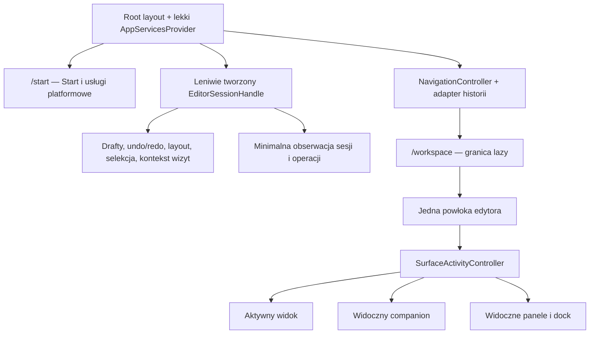

# Plan refaktoryzacji Control Room: lekki Start, aktywność widoków i historia nawigacji

Data: 20.10.2026. Status: **PROPOSED — plan, bez wdrożenia**.

Podstawa: [audyt architektury](../../../reports/2026-10-20/frontend-architecture/AUDYT.md), ustalenia F01–F10 oraz prośba o nawigację Wstecz/Dalej.

## 1. Cel i rekomendacja

Docelowo Fullmag ma lekki ekran `/start`, jeden edytor `/workspace`, widoki ładowane i aktywowane według potrzeb oraz wspólną historię nawigacji aplikacji i przeglądarki. Przejście na Start nie niszczy dokumentu, draftów, historii edycji ani powiązania z sesją; zwalnia natomiast zasoby niewidocznych rendererów.

**Wstecz/Dalej jest przydatne w tym produkcie.** Przykład:

```text
3D / obiekt A → Field Map / monitor M → Analysis / dataset D
                         ← Wstecz
                         Dalej →
```

Powrót przywraca odpowiedni widok, semantyczny wybór i ustawienia prezentacji. Nie odtwarza historycznego stanu fizycznego modelu. Nie wymaga pozostawienia poprzednich okien w DOM.

Rozdzielamy dwa mechanizmy:

| Mechanizm | Co robi | Czego nie robi |
|---|---|---|
| **Wstecz / Dalej** | Nawiguje między odwiedzonymi miejscami UI | Nie zapisuje sceny, nie cofa zmian fizyki, nie uruchamia komend solvera |
| **Cofnij / Ponów** | Wykonuje istniejącą historię zatwierdzonych operacji authoring | Nie służy do powrotu na poprzednią zakładkę |

Pozostają jedna aplikacja, jeden klient API, jeden model projektu i wspólne drzewo workspace dla FDM/FEM. Nie planujemy microfrontends, osobnych deploymentów ani wymiany Next.js.

## 2. Stan zweryfikowany i założenia

Plan przygotowano na `master`, HEAD `a63b50ca0c0c4b457f440b0ac276b483d282c555`, w `C:\git\fullmag\fullmag`. Status ograniczony do aplikacji i specyfikacji frontendu był pusty. Porównanie z końcowym inwentarzem audytu: **0 zmienionych z 2335 sprawdzonych plików**. Nie przenosimy wcześniejszych wyników na przyszłe źródła implementacji.

Stan obecny, potwierdzony odczytem:

- `app/page.tsx:10–11` przekierowuje do `/workspace`; `app/workspace/page.tsx:10–16` montuje cały `KernelProvider`.
- `KernelProvider.tsx:107–259` tworzy usługi, a `:822–836` wiąże je z providerem strony.
- `WorkspaceShellClient.tsx:219–253` zachowuje edytor pod HomeOverlay; `homeView.ts` jest flagą widoku.
- `LayoutController.ts:34–194` steruje układem i publikuje zmiany, ale nie rozróżnia transakcji nawigacji użytkownika od odtworzenia/systemowej aktualizacji.
- `controlRoomUiState.ts:91–102` zapisuje część układu; nie zapisuje companion.
- `PendingFormRegistry` przechowuje status i callbacki właścicieli, nie wartości wszystkich draftów. Specyfikacja `04-state-management.md`, sekcja 6, opisuje ten kontrakt.
- `AuthoringHistoryController.ts:101–110` ma historię semantyczną opartą na zatwierdzonych transakcjach; `shellCommands.ts:460–515` udostępnia `workspace.undo` i `workspace.redo`.
- `authoringHistoryWorkspaceRestore.ts:82–118` odtwarza selekcję warunkowo i chroni nowszy wybór użytkownika. Nowa nawigacja musi zachować tę zasadę.

Nazwy nowych usług, typów, plików i komend w tym planie są **proponowane**, nie istniejące API. Przed wdrożeniem należy ponownie sprawdzić checkout i jego instrukcje.

Przyjmujemy jeden aktywny dokument/kontekst edycji na kartę aplikacji. Historia nawigacji nie wprowadza obsługi równoległych sesji ani automatycznego przełączania backendowego `/sessions/current`.

Dokument może istnieć bez aktywnej sesji wykonania. Zakres stanu rozróżnia `project-only` oraz dokument powiązany z sesją; nie tworzymy sztucznego `sessionId`. Pierwsze powiązanie z runtime wymaga jawnego przeniesienia zgodnych draftów dokumentu i sprawdzenia baseline, zamiast potraktowania go jak otwarcia obcego projektu.

## 3. Zapis proponowanej decyzji architektonicznej

### Kontekst

Obecne zachowanie Home zapewnia retencję draftów przez utrzymanie całego edytora. Leniwe moduły istnieją, ale aktywność zasobów jest częściowo oparta na jednym identyfikatorze zakładki i tekstowym dopasowaniu kluczy. Routing nie oddziela Start od uruchomienia edytora.

### Decyzja proponowana

1. `/start` jest kanonicznym lekkim wejściem; `/` przekierowuje do `/start`. Bezpośrednie `/workspace` nadal działa.
2. Wspólny root zawiera lekki fundament usług, a usługi edytora są tworzone leniwie i zachowywane niezależnie od jego widoków.
3. Drafty i historia zatwierdzonej edycji mają okres życia dokumentu/powiązania sesji, nie formularza.
4. Główne renderery są odmontowywane po utracie widoczności; identyfikatory, preferencje i stan wizyty pozostają.
5. Aktywność wyliczamy ze zbioru odbiorców danych i powierzchni primary/companion/dock, uwzględniając Start i widoczność karty.
6. Historia przeglądarki jest jedynym mechanizmem przechodzenia Wstecz/Dalej. Lokalny rejestr wpisów przechowuje małe metadane odtworzenia, a nie drugi konkurencyjny stos nawigacji.

### Konsekwencje i obowiązki

Trzeba zmienić kontrakt własności draftów w specyfikacji stanu, usunąć HomeOverlay jako sposób przechowania edycji i zdefiniować publiczny kontrakt nawigacji/aktywności. Jest to zakres ADR modułowego kernela i workspace. W etapie P01 należy przygotować numerowany ADR zgodnie z aktualnym rejestrem; ten dokument jest propozycją, nie przyjętym ADR.

Nie zmienia się fizyka, `ProblemIR`, semantyka solvera ani publiczne zasoby API. Jeżeli wdrożenie ujawni rzeczywistą potrzebę zmiany API, należy osobno rozszerzyć zakres kontraktu i generację OpenAPI; nie dodawać endpointu tylko dla ułatwienia nawigacji.

Mosty migracyjne: istniejące `workspace.home`, `workspace.return-to-workspace`, `homeView` i wywołania setterów layoutu. Właścicielem ich migracji jest etap P05/P06. Po przełączeniu wszystkich producentów intencji i przejściu regresji mają zostać usunięte lub stać się cienkim adapterem do jednej implementacji.

Rollback musi zachować dostęp do nowego właściciela draftów i już zatwierdzonej historii. Powrót do starego renderowania nie może czyścić pracy użytkownika.

## 4. Docelowe granice własności



### 4.1 Lekki fundament i zachowana sesja edytora

Proponowany `AppServicesProvider` dostarcza stabilny obiekt usług przez context. Mutable state pozostaje w controllerach/store i jest czytany przez selektory. Nie powstaje nowy „globalny React context ze wszystkim”.

Root nie może statycznie importować `KernelProvider`, rejestru wszystkich modułów, `viewport-3d/public`, Inspectora ani rendererów. Fabryka `EditorSessionHandle` jest osiągana przez dynamiczny import przy pierwszym wejściu do edytora. Wspólny transport API ma jednego właściciela; nie tworzymy nowego klienta przy każdej zmianie trasy.

Po powrocie na Start zachowany handle przechowuje:

- aktualne powiązanie dokumentu i potwierdzonej sesji;
- wartości draftów, walidację, baseline i stan trwających zapisów;
- istniejący `AuthoringHistoryController` z jego stosami i generation guard;
- niewielki stan layoutu, selekcji i prezentacji;
- obserwację trwających komend/run outcomes potrzebną do ich bezpiecznego rozliczenia.

Nie przechowuje przez to aktywnych canvasów, drzew formularzy, workerów renderowania ani wielkich kopii pól. Sama obecność handle nie oznacza aktywności UI.

`SessionRuntimeConnectors` należy rozdzielić według odpowiedzialności. Minimalny control plane i rozliczanie wyników mogą działać po opuszczeniu edytora; konektory wizualizacji i żądania ciężkich danych wymagają odbiorcy. Nie wolno odłączyć obserwacji ACK tylko dlatego, że użytkownik otworzył Start.

**Cold Start** nie tworzy handle. **Warm Start** po odwiedzeniu edytora może mieć załadowany wcześniej kod JS i zachowany lekki stan. Nie obiecujemy „wyładowania JavaScriptu” z cache przeglądarki.

### 4.2 Klasy stanu i retencja

| Stan | Właściciel docelowy | Przejście widoku / Start | Reload / zamknięcie |
|---|---|---|---|
| Kanoniczna scena, sesja, wyniki | API + resource hooks/cache | Zachować tożsamość; pobierać według odbiorców | Ponownie potwierdzić w API |
| Draft formularza, również niepoprawny tekst | Modułowy store draftu utrzymywany przez sesję edytora | Zachować najnowszą treść i baseline | W pierwszym zakresie brak obietnicy trwałego odzysku |
| Undo/redo zatwierdzonego authoring | Istniejący controller sesji edytora | Zachować obie gałęzie historii | Bez automatycznego odtwarzania zapisów API |
| Kamera, zakres wykresu, scroll, wybrany subview | Mały snapshot wizyty / store prezentacji | Odtworzyć przy powrocie | Tylko zwalidowane preferencje/layout |
| Status applying/pending/unknown ACK | Controller transakcji, niezależny od komponentu | Obserwacja trwa | Reconcile według istniejących kontraktów; bez powtórzenia zapisu |
| WebGL/ECharts/worker/observer | Zamontowana powierzchnia | Dispose/release po utracie odbiorcy | Tworzone od nowa |
| Pola, topologia, duże tabele | Współdzielona warstwa zasobów | Release/evict według ownership i budżetu | Nie kopiować do history.state/localStorage |

Retencja draftów w tym planie obejmuje nawigację wewnątrz tej samej działającej aplikacji. Nie wprowadzamy cichego autosave do modelu ani zapisu draftów na dysk. Odzysk po awarii/odświeżeniu wymagałby odrębnego kontraktu trwałości; obecnie stosujemy ostrzeżenie o niezapisanej pracy, z jawnymi ograniczeniami platformy.

### 4.3 Kontrakt draftu

Proponowane metadane rekordu:

```text
scope = documentId + documentGeneration + binding
binding = project-only | (sessionId + sessionEpoch + requestScopeEpoch)
draftKey = scope + targetKind + immutableTargetId + panel/schemaVersion
record = values + baselineRevision + dirtyFields + validation
         + draftGeneration + pendingOperationIdentity + conflictState
```

To schemat koncepcyjny; dokładne typy muszą reuse'ować istniejące typy edit-session, a nie tworzyć równoległego systemu.

- Wartość jest zapisana w ownerze przy edycji pola, a nie dopiero w cleanupie React. Dotyczy również niekompletnego wpisu, np. `1e-`.
- `PendingFormRegistry` nadal agreguje gotowość do Apply/Reset/zmiany projektu. Controller draftu, a nie odmontowany komponent, utrzymuje rejestrację.
- Przy remount panel dostaje najnowszy draft. Nie inicjalizuje go ponownie z ostatniej odpowiedzi serwera.
- ACK musi zgadzać się ze scope, targetem, identyfikatorem operacji i generacją draftu; nie usuwa późniejszej edycji.
- Zmiana rewizji kanonicznej nie nadpisuje dirty draftu. Powstaje jawny konflikt/rebase zgodnie z istniejącą sesją edycji.
- Brak targetu po usunięciu obiektu nie pozwala użyć draftu dla obiektu o tej samej nazwie. Pozostaje informacja o nieaktualnym celu i jawne rozstrzygnięcie.
- Czyste drafty można usuwać z cache; dirty/applying nie podlegają automatycznej eksmisji. Przy przekroczeniu budżetu wymagane jest zachowanie danych i jawne rozstrzygnięcie, nie ciche odrzucenie.
- Zmiana projektu/sesji jest osobną operacją, chronioną istniejącym transition guard. Back nie otwiera automatycznie archiwum ani nie zmienia `/sessions/current`.

Obecne guardy selekcji i mesh-build nie stanowią kompletnego guardu zmiany route/projektu. Trzeba jawnie podłączyć wszystkie operacje zastępujące dokument do przygotowania przejścia. Obecne czyszczenie draftów i authoring history przy `session:status-changed("idle")` w `KernelProvider.tsx:160–170` wymaga rozdzielenia zamknięcia dokumentu od chwilowego braku sesji/reconnect. Sam Start nigdy nie emituje zdarzenia zamykającego dokument. Prawdziwe zastąpienie tożsamości unieważnia stare ACK i historię; przejściowa utrata połączenia nie może kasować pracy.

Odtworzenie kamery/zakresu wykresu jest operacją prezentacji. Trzeba prześledzić `VisualizationRegistrySyncController` i `CameraRegistryController`, aby odtworzenie z origin `history-restore` nie uruchamiało wtórnego zapisu do API. Nie odtwarzamy z historii nawigacji historycznych ustawień wizualizacji należących do kanonicznego dokumentu.

## 5. Kontrakt Wstecz/Dalej

### 5.1 Co stanowi miejsce nawigacji

Proponowany `NavigationLocation` zawiera wyłącznie dane potrzebne do odtworzenia miejsca:

```text
route: start | workspace
documentBinding: mały identyfikator dokumentu i generacji powiązania
startSection?
ribbonContext?
primarySurface?
companion?: moduleId + placement
analysisSubview? / datasetRef? / planarMonitorRef?
selection?: semantyczny identyfikator celu
inspectorSection?
bottomTab? + panelVisibility?
```

Oddzielny `ViewVisitSnapshot`, pod `entryId`, zawiera kamerę, zoom/range, scroll i klucz focusu. Nie zawiera DOM nodes, closure, rendererów, danych pól ani kopii draftów. Nazwy są propozycją.

### 5.2 Polityka zapisywania historii

| Działanie | Historia |
|---|---|
| Start ↔ workspace | `push`, z zachowaniem dokumentu |
| Świadomy wybór 3D / Field Map / Analysis / Live Charts | `push` |
| Zmiana kontekstu ribbon, podwidoku analiz lub sekcji Start | `push`, jeżeli zmienia semantyczne miejsce |
| Wybranie innego obiektu, wyniku lub datasetu do inspekcji | `push` dla zakończonej intencji; jedna złożona akcja = jeden wpis |
| Otwarcie/zamknięcie companion | `push`; konfiguracja splitu należy do miejsca |
| Zmiana głównej zakładki docka | `push` przy świadomej nawigacji do zawartości |
| Resize, scroll, zoom, obrót kamery, zakres suwaka | Aktualizacja snapshotu bieżącej wizyty; bez nowego wpisu |
| Hover, tooltip, focus pola, rozwinięcie zwykłej grupy | Bez wpisu |
| Modal potwierdzenia, menu, transient toast | Bez wpisu; nie projektować „Back potwierdza/anuluje operację” |
| Apply/Undo/Redo, ACK, realtime, automatyczna korekta selekcji | Bez `push`; ewentualne uzgodnienie bieżącego wpisu |
| Odtworzenie Back/Forward albo odświeżenie danych | Bez ponownego zapisu historii |
| Kliknięcie już aktywnego miejsca | No-op |

Wielokrotna zmiana selekcji w ramach jednego gestu/akcji klawiatury ma być grupowana. Nie generujemy historii po każdym zdarzeniu `pointermove` lub `keydown repeat`. Definicja granic gestu jest częścią adaptera producenta intencji, nie globalnego timera maskującego duplikaty.

### 5.3 Przewidywalne zachowanie

- Back z Analysis do Field Map odtwarza monitor, komponent prezentacji, wybór i ustawienia tamtej wizyty; dane są odczytywane jako aktualne dla wskazanego zasobu.
- Po Back i wyborze nowego miejsca przeglądarka odcina gałąź Forward. Aplikacja usuwa odpowiadające jej metadane.
- Back nie odtwarza starej wartości draftu. Po powrocie widać najnowszą niezastosowaną edycję tego celu.
- Undo/Redo mogą warunkowo zmienić selekcję zgodnie z obecnym controllerem, ale nie dodają nowych wizyt.
- Przy usuniętym obiekcie/datasetcie aplikacja pokazuje niedostępny cel albo bezpieczny nadrzędny widok z komunikatem. Nie wykonuje automatycznie Create/Restore/Solve, aby „odtworzyć” miejsce.
- Wpis z innego session epoch/request scope nie może przywrócić danych lub draftów poprzedniej sesji. Dostępna jest informacja o nieaktualnym kontekście i przejście do aktualnego.
- Zwykły timeout API nie jest nową sesją. Zachowujemy last-confirmed identity, oznaczamy stale/unavailable i blokujemy niebezpieczne mutacje; nie czyścimy draftów przy chwilowym reconnect.
- Powrót do widoku z brakiem chunka pokazuje lokalny loading/error i możliwość odzyskania. Pozostały shell i drafty pozostają.

### 5.4 Integracja z przeglądarką i Next.js

Proponowany `BrowserNavigationAdapter` jako jedyny zapisuje nawigację:

1. `/start` ↔ `/workspace` przechodzi przez App Router.
2. Zmiana miejsca wewnątrz workspace korzysta z obsługiwanego mechanizmu routera/native History API, bez hard reload.
3. URL zawiera małe, walidowane identyfikatory miejsca, np. `/workspace?view=field-map&context=results`; szczegóły niewymagane do linku pozostają w snapshotach.
4. Adapter zachowuje własne pola Next w `history.state`; metadane Fullmag są namespacowane. Nie zastępuje całego obiektu stanem aplikacji.
5. Każda zaakceptowana intencja ma `transitionId`; zatwierdzenie trasy i zapis metadanych są uzgadniane idempotentnie. Jedna intencja nie może dać dwóch wpisów.
6. `popstate`/zmiana trasy odtwarza stan z pochodzeniem `history`, bez wywoływania kolejnego `push`. Szybkie Back/Forward stosuje ostatnią ważną generację odtworzenia; późny import/response nie przejmuje aktualnego widoku.
7. Rejestr aplikacji opisuje tylko znane własne wpisy. Przyciski aplikacji nie wyprowadzają użytkownika poza znany zakres Fullmag; natywny Back zachowuje zwykłą możliwość opuszczenia strony.
8. Proponowany początkowy budżet: 100 snapshotów wizyt na dokument. Przeglądarkowego stosu nie przycinamy ani nie zastępujemy. Starszy wpis bez snapshotu odtwarza tylko zwalidowany URL, bez obietnicy odzyskania scrolla/kamery.
9. Preferencje mogą przeżyć reload, ale URL ma pierwszeństwo dla jawnie wskazanego miejsca. Częściowy URL uzupełniamy bezpiecznymi preferencjami i bieżącą tożsamością; nie aktywujemy innego projektu na podstawie query.

Adresy i format history metadata należy wersjonować. Nie wkładamy do URL ścieżek plików hosta, payloadów projektu, sekretów ani nieograniczonych danych.

Next dokumentuje integrację native `pushState`/`replaceState` z routerem. Przed wyborem szczegółowego adaptera wymagany jest mały browser spike na przypiętej wersji aplikacji, również w static export/desktop. Dokumentacja: [Next.js navigation](https://nextjs.org/docs/app/getting-started/linking-and-navigating), [useRouter](https://nextjs.org/docs/app/api-reference/functions/use-router).

**Istotne ograniczenie:** `popstate` przychodzi w trakcie już wykonywanego przejścia; `preventDefault()` nie jest ogólnym sposobem anulowania Back. Dlatego nawigacja po widokach ma być bezpieczna dzięki wcześniejszej retencji draftu, a nie sztucznemu „uwięzieniu” użytkownika w historii. Wyjście z dokumentu/reload używa `beforeunload` tylko gdy jest niezapisana praca; jego skuteczność zależy od platformy. Nie obiecujemy trwałości po ubiciu procesu. Źródła: [MDN popstate](https://developer.mozilla.org/en-US/docs/Web/API/Window/popstate_event), [MDN beforeunload](https://developer.mozilla.org/en-US/docs/Web/API/Window/beforeunload_event).

### 5.5 Interfejs użytkownika

- Dwie strzałki w stałym nagłówku: **Wstecz**, **Dalej**. Oddzielone od **Cofnij zmianę**, **Ponów zmianę**.
- Tooltip pokazuje cel, np. „Wstecz: Field Map — Monitor 1”; brak celu oznacza disabled z poprawną nazwą dostępną.
- Opcjonalne menu ostatnich miejsc jest późniejszym dodatkiem; nie jest wymagane do pierwszej dostawy.
- W przeglądarce nie przechwytujemy ponownie natywnych Alt+Left/Alt+Right. Desktop mapuje skróty do tego samego adaptera tylko tam, gdzie host ich sam nie obsługuje. Nie używamy Backspace jako globalnego Back.
- Focus po powrocie trafia do istniejącego bezpiecznego celu lub nagłówka powierzchni. Odtworzenie nie kradnie focusu nowszej interakcji.
- Przyciski i palette korzystają z proponowanych komend `navigation.back` i `navigation.forward`; dotychczasowe `workspace.undo/redo` zachowują semantykę.

## 6. Model aktywności powierzchni i danych

Proponowane dwa poziomy:

1. `SurfaceActivityController` wylicza aktywne instancje powierzchni.
2. Resource layer agreguje zapotrzebowanie ich konsumentów na zasób.

```text
surface active = właściwa trasa
                 AND powierzchnia jest faktycznie widoczna
                 AND capability pozwala ją pokazać

resource demanded = istnieje aktywny konsument
                    OR jawny minimalny odbiorca control plane
```

`document.visibilityState` zatrzymuje pracę prezentacyjną w ukrytej karcie, lecz nie oznacza zatrzymania symulacji ani porzucenia ACK.

| Sytuacja | Renderer / dane widokowe | Control plane |
|---|---|---|
| Zimny Start | Brak 3D/2D/ECharts i ich payloadów | Projekty, możliwości hosta, status potrzebny Start |
| Workspace, primary 3D | Aktywny 3D; inne powierzchnie niezamontowane | Sesja i operacje |
| Analysis + 3D companion | Oba widoczne odbiorniki aktywne | Sesja i operacje |
| Workspace + Quick Chart | Primary i widoczny wykres docka | Sesja i operacje |
| Warm Start po edytorze | Renderery odmontowane, ciężkie zapotrzebowanie zwolnione | Obserwacja trwających operacji i wyników |
| Ukryta karta przeglądarki | Wstrzymane redraw i zbędne odświeżenia; polityka retencji jawna | Minimalna obsługa aktualnego procesu |

Najpierw poprawiamy rozpoznawanie scoped keys **łącznie** z uwzględnieniem companion i współdzielonych konsumentów. Docelowo decyzja nie opiera się wyłącznie na regexie URL. Tożsamość zasobu, scope klienta/sesji i demand są odrębnymi wartościami.

Zwolnienie jednego odbiorcy nie abortuje requestu potrzebnego drugiemu. Ostatni odbiorca zwalnia lease/subskrypcję, pozwala anulować load i uruchamia istniejącą politykę cache. Unieważnienia mogą zachować wskaźnik rewizji bez natychmiastowego pobierania nieużywanego payloadu; powrót wznawia aktualne zapotrzebowanie.

W Analysis katalog datasetów może być potrzebny kilku podwidokom, ale rows time-traces tylko odpowiedniemu konsumentowi. Nie uzależniamy całej rodziny payloadów od samego `activeSurface === "dynamics"`.

## 7. Plan wykonania

Każdy etap jest osobnym spójnym wynikiem do review/commita po adekwatnej weryfikacji. **Żaden nie jest obecnie wykonany.** Implementacja ma używać izolacji i cyklu integracji repozytorium; ten plan nie uruchamia tego cyklu.

### P00 — przypięcie źródeł, baseline i spike historii

**Właściciel:** integrator. **Zależności:** brak.

**Pliki istniejące:** `apps/control-room/package.json`, `next.config.ts`, `app/layout.tsx`, `app/workspace/page.tsx`, `scripts/audit-viewport-main-tab-memory.mjs`, `scripts/audit-idle-performance.mjs`, `scripts/check-start-screen-browser.mjs`; Docker recepty wskazane przez `justfile`.

**Działania:**

- Przypiąć SHA/worktree i grupę Compose; zapisać źródła i parametry pomiaru.
- Zmierzyć cold/warm Start, pierwszy workspace i 20–50 cykli tabów na pustym projekcie oraz reprezentatywnym FDM/FEM.
- Rozdzielić DEV cold compile/HMR od produkcyjnego JS/CSS i czasu interakcji.
- Spike potwierdza jeden wpis historii dla zmiany trasy i query, Back/Forward, zachowanie root providera, własne `history.state`, reload i desktop/static export.
- Sprawdzić receptę wykonania wymaganych kontroli w aktualnych ograniczeniach. Brak zgodnej ścieżki zapisuje blocker, nie uruchamia hostowego builda.

**Odbiór:** baseline z provenance, decyzja o dokładnym adapterze Next/native history oraz lista brakujących dowodów. Bez produkcyjnego pomiaru nie deklarować zmniejszenia bundla.

### P01 — kontrakty i ADR

**Właściciel:** integrator. **Zależności:** P00.

**Pliki istniejące:** `docs/specs/frontend-v2/01-module-kernel-architecture.md`, `02-module-catalog.md`, `04-state-management.md`, odpowiednie specy viewportów i dokumenty Start. **Nowe:** numerowany ADR po sprawdzeniu rejestru, spec nawigacji i aktywności.

**Działania:** zatwierdzić ownership handle/draftów, miejsce w historii, zakres retencji i testy. Jawnie zmienić wcześniejsze założenie draftu lokalnego względem mountu. Spisać różnicę visibility/activity/demand, zasady stale-session i jednoznaczne granice rollbacku.

**Odbiór:** brak sprzeczności ze wspólnym workspace/API; spec oznacza stan planned, nie implemented. Wszystkie proponowane nazwy są jawne.

### P02 — właściciel sesji edytora niezależny od trasy

**Właściciel:** worker A — kernel i lifecycle. **Zależności:** P01.

**Zmiany istniejących plików:** `src/kernel/KernelProvider.tsx`, `KernelContext.tsx`, `types.ts`, `persistence/ProjectDocumentController.ts`, `persistence/RunOutcomeConnector.tsx`.

**Nowe proponowane:** `kernel/app/AppServicesProvider.tsx`, `kernel/app/AppServices.ts`, `kernel/session/EditorSessionHandle.ts`, `kernel/session/createEditorSession.ts`, `kernel/session/RetainedSessionServicesHost.tsx`.

**Działania:** wydzielić fabrykę obecnych usług bez tworzenia duplikatów; root przechowuje mały uchwyt i wczytuje fabrykę dopiero na żądanie. Rozdzielić control plane od widokowych konektorów. Zdefiniować `acquire/get/release/close` i session generation; jeden owner na klient, komendy i historię.

**Odbiór:** dwukrotne wejście do workspace nie tworzy drugiego klienta/obserwatora wyników ani pustej historii; warm Start nie trzyma rendererów przez ownership usług. Cold Start nie importuje ciężkiej fabryki statycznie.

### P03 — drafty niezależne od formularzy

**Właściciel:** worker B — Inspector i authoring. **Zależności:** kontrakt P02; równoległość dopiero po jego ustaleniu.

**Pliki:** `modules/inspector/InspectorEditSession.tsx`, `InspectorDirtySelectionGuard.tsx`, `InspectorModule.tsx`, draft-owning panele i hooki; `kernel/authoring/PendingFormRegistry.ts`, `object-edit/ObjectEditSessionController.ts`, `authoringHistoryWorkspaceRestore.ts`. Reuse `primitives/quantityFieldDraftStore.ts`, jeśli obecny kontrakt pozwala; nie traktować go jako kompletnego ownera wszystkich formularzy.

**Nowe proponowane:** prywatny store/controller draftów Inspectora z adapterami poszczególnych rodzin; mały interfejs rejestracji ownera do kernela.

**Działania:** zinwentaryzować wszystkie `useState`/reducery draftów, nie tylko Geometry. Przenieść wartości/baseline/validation/pending do właścicieli sesji; UI pozostaje subskrybentem. Zachować interfejs transition registry dla operacji destrukcyjnych.

**Odbiór:** dirty i invalid draft przeżywa unmount/remount oraz Home; ACK po unmount rozlicza właściwą generację; newer draft nie jest kasowany. Niezmigrowany formularz blokuje włączenie nowej nawigacji w danym zakresie — nie można zabezpieczyć native Back wyłącznie disabled przyciskiem aplikacji.

### P04 — poprawna aktywność i zapotrzebowanie

**Właściciel:** worker A. **Zależności:** P01–P02.

**Pliki:** `kernel/resources/inactiveViewportResourcePolicy.ts`, `resourceClientScope.ts`, `sessionResourceIdentity.ts`, `ResourceRuntimeStore.ts`, `useResource.ts`; `layout/ViewportTabHost.tsx`, `WorkspaceDockLayout.tsx`; resource hooki 3D/Field Map i `analysis-plots/hooks/useAnalysisDatasetData.ts`.

**Nowe proponowane:** `kernel/activity/SurfaceActivityController.ts`, `surfaceActivityTypes.ts`, adapter demand do istniejącego runtime store.

**Działania:** rozdzielić canonical path od cache identity; agregować demand primary/companion/dock/Inspector. Usunąć globalne blokowanie payloadu potrzebnego innemu konsumentowi. Dodać politykę hidden-document i podwidoków analiz.

**Odbiór:** scoped keys działają, companion jest aktualny, jeden consumer nie abortuje drugiego, nieaktywny widok nie powoduje nowych heavy loads. Dopiero po tych kontrolach usuwać stary pause controller.

### P05 — rdzeń nawigacji i odtwarzanie widoków

**Właściciel:** worker A/integrator. **Zależności:** P02–P04; P03 przed włączeniem dla użytkownika.

**Pliki:** `layout/LayoutController.ts`, `layout/layoutTypes.ts`, `selection/SelectionController.ts`, `persistence/controlRoomUiState.ts`, `commands/commandTypes.ts`, `events/eventTypes.ts`.

**Nowe proponowane:** `kernel/navigation/NavigationController.ts`, `navigationTypes.ts`, `navigationCodec.ts`, `BrowserNavigationAdapter.ts`, `ViewVisitStore.ts`, `navigationCommands.ts`.

**Działania:**

- Jedno wejście `navigate(intent)` i odrębne `restore(location, origin)`.
- Codec URL z allowlistą modułów/podwidoków, limitami i wersją.
- Atomowe zastosowanie layoutu, selekcji, kontekstu analiz i activity; unikać chwilowego montowania domyślnego 3D przed docelowym Field Map.
- Wprowadzić origin: `user`, `history`, `system`, `authoring-history`, `hydration`, `project-restore`; do historii trafia tylko zatwierdzona intencja użytkownika.
- Snapshot wizyty jest zapisywany przed opuszczeniem; brak powielania małych store jako nowych źródeł prawdy.
- Zserializować companion i wersjonować UI layout z migracją starego formatu.

**Odbiór:** Back/Forward i nowa gałąź działają, restore nie dodaje wpisów, reentrancy/late async nie nadpisuje najnowszego miejsca, invalid target nie wywołuje mutacji API.

### P06 — trasy Start/workspace i przyciski

**Właściciel:** integrator — routing i chrome. **Zależności:** P03–P05.

**Pliki:** `app/page.tsx`, `app/layout.tsx`, `app/workspace/page.tsx`, `next.config.ts`, `next.config.test.ts`, `layout/WorkspaceShellClient.tsx`, `WorkspaceShell.tsx`, `AppMenuBar.tsx`, `shellCommands.ts`, `homeView.ts`, `modules/start/StartScreen.tsx`, `src/design/styles/layout.css`.

**Nowe proponowane:** `app/start/page.tsx`, `kernel/layout/NavigationControls.tsx`; lekki Start entry niezależny od pełnego `ModuleProps/KernelApi`, jeśli potrzebny.

**Działania:** root → `/start`, przejście do workspace po otwarciu/utworzeniu/wznowieniu kontekstu. Start korzysta z wąskiego kontraktu platformy/komend. Usunąć ukryty dock pod Home. Header zachowuje jedną wspólną warstwę UI i osobne menu zależne od kontekstu. Podłączyć przyciski i palette do jednego adaptera.

**Ważny konsument:** `next.config.ts:333–337` ma wczesny redirect dla probe launchera. Zmiana celu nie może zmusić probe do zimnej kompilacji workspace. Sprawdzić `docker/all-in-one/frontend_dev.py`, launchery i smoke URL; aktualizować tylko faktycznych konsumentów.

**Odbiór:** `/`, `/start`, bezpośrednie `/workspace`, reload/query, desktop/static export i frontend readiness działają. Po wejściu na Start zero zamontowanych ciężkich powierzchni; działający backend nie jest zatrzymywany. Retencja P03 nie zależy już od HomeOverlay.

### P07 — migracja producentów intencji

**Właściciel:** integrator z workerami domenowymi. **Zależności:** P05–P06.

**Pliki:** `ViewportTabHost.tsx`, `modules/ribbon/ribbonCommands.ts`, `ribbonContributions.tsx`, Explorer, Results Navigator, Start rail, Footer, selection producers 3D/Field Map, kontrolery `ChartViewportHandoffController` i analiz.

**Działania:** sklasyfikować wszystkie wywołania `setActiveTab`, `setActiveViewportMainModule`, `setViewportCompanion`, `selection.set`, zmiany subview/dataset. Akcje użytkownika wysyłają jedną intencję; niskopoziomowe settery pozostają mechanizmem zastosowania/restore. Nie doklejać historii do każdej emisji event bus.

**Odbiór:** klik wyniku otwierający Results + Analysis + dataset + Inspector daje jeden wpis. Auto-ACK, sesyjny reconnect, hydration i authoring undo nie produkują wpisów. Wszystkie dostępne sposoby przełączenia widoku mają spójne zachowanie.

### P08 — rzeczywiste granice lazy

**Właściciel:** worker B oraz domenowe podzadania po P07. **Zależności:** P02–P03; kontrakt nawigacji P05.

**Pliki:** `modules/registry.ts`, manifesty, `viewport-3d/public.ts`, `viewport3dStore.ts`, `viewport3dVisualProfile.ts`, `inspector/inspectorRouteCatalog.tsx`, `inspectorRegistry.tsx`, `start/StartScreen.tsx`, `AppMenuBar.tsx`, `analysis-plots/AnalysisPlotsView.tsx`.

**Działania:** wydzielić renderer-neutral profil/metadane, małe publiczne adaptery, rodziny Inspectora (Geometry/Mesh/Physics/Study/Results), importer, ustawienia i duże analizy. Lekkie manifesty zawierają opis komend; ciężkie wykonanie ładuje się po intencji. Dialogi ładować po otwarciu. Zachować jeden kernel/registry.

Sprawdzić również tranzytywne importy fasady API używanej przez Start. Jeżeli wciąga kodeki binarne lub implementacje specyficzne dla edytora, wydzielić lekkie interfejsy i leniwą inicjalizację tych części, zachowując jeden typowany transport, spójną tożsamość klienta i wspólny runtime zasobów. Nowy ekran nie uzasadnia drugiego klienta API.

**Odbiór:** cold Start nie ładuje kodu ciężkich powierzchni ani całego Inspectora. Wybrany panel nie wymaga kodu wszystkich rodzin. Produkcyjny chunk graph i Network potwierdzają efekt; sama obecność `lazy()` nie wystarcza. Prefetch tylko świadomy i z budżetem, bez ładowania wszystkich modułów na idle.

### P09 — loading, recovery i CSS

**Właściciel:** worker B. **Zależności:** P08.

**Pliki:** `layout/SlotHost.tsx`, `app/globals.css`, `design/styles/*`, lokalne granice błędów i ładowania.

**Działania:** odróżnić błąd importu od renderu, zapewnić retry z odpowiednią generacją loadera i fallbackiem po zmianie wersji deploymentu. Zachować globalne tokeny i bazę, przenieść ciężkie style do właściwych granic. Utrzymać stabilne wymiary placeholderów, hydration i focus.

**Odbiór:** odzyskanie po błędzie chunka nie gubi draftu; brak nieskutecznej pętli Retry, FOUC i remountu formularza przy zwykłym ACK. Brak efektu poprawiającego wynik tylko dzięki obniżeniu jakości wizualizacji.

### P10 — kwalifikacja, dokumentacja i usunięcie mostów

**Właściciel:** integrator. **Zależności:** wszystkie powyższe.

**Pliki:** istniejące skrypty audit/smoke, specy/ADR, rejestr migracji; nowe testy opisane poniżej.

**Działania:** wykonać macierz regresji na tym samym source identity, zamknąć wszystkie F01–F10, usunąć martwy HomeOverlay i alternatywne ścieżki przełączania. Porównać cold/warm z baseline. Sprawdzić legacy route links i migrację layoutu.

**Odbiór:** źródła, przeglądarka i metryki mają oddzielne dowody; obowiązujące bramki przeszły. Wymagana, niedostępna bramka pozostaje blockerem. Potem cykl repo: review → wymagane kontrole → integracja → weryfikacja i dozwolony cleanup.

## 8. Testy regresji

To **plan testów**, nie deklaracja ich wykonania. Obowiązuje aktualny zakaz kompilowania testów jednostkowych. Nie uruchamiać ich ani automatycznej ścieżki CI kompilującej testy, dopóki użytkownik nie odwoła zakazu. Można przygotować źródła testów; wymaganych wyników nie zastępuje przegląd kodu. Pełna kwalifikacja wdrożenia pozostaje wtedy niezamknięta.

### 8.1 Macierz funkcjonalna

| ID | Scenariusz | Wymagany wynik |
|---|---|---|
| N01 | 3D → Field Map → Analysis → Back → Forward | Dokładne miejsce, selekcja i podwidok; po jednym kroku |
| N02 | Back, potem nowy widok | Forward dla porzuconej gałęzi znika |
| N03 | Browser Back/Forward, przyciski UI, desktop shortcuts | Jeden mechanizm, bez podwójnego przejścia |
| N04 | Jeden klik wyniku zmienia kilka store | Jeden wpis i atomowy docelowy layout |
| N05 | 100 obrotów kamery / slider drag / resize | Brak 100 wpisów historii; snapshot wizyty aktualny |
| N06 | ACK/realtime/hydration/Undo/Redo | Zero dodatkowych wpisów |
| N07 | Szybkie Back/Forward podczas importu/fetchu | Ostatnia intencja wygrywa; brak stale navigation |
| N08 | Nieznany URL, usunięty obiekt/dataset | Bezpieczny fallback, komunikat, zero mutacji |
| N09 | Zmiana session epoch lub API instance | Żadnego starego draftu/payloadu; jawny nieaktualny kontekst |
| N10 | Starszy wpis bez snapshotu, reload, direct link | Odtworzenie z URL/preferences zgodnie z kontraktem |
| D01 | Dirty Geometry → Start → Back | Identyczne values/baseline/generation; brak zapisu API |
| D02 | Niepoprawny tekst QuantityField i draft study/physics | Zachowana surowa treść i komunikat walidacji |
| D03 | Apply → odejście → ACK | Zapis rozliczony raz; cleanup UI nie anuluje commit/reconcile |
| D04 | Nowa edycja podczas starszego ACK | Nowy draft pozostaje dirty |
| D05 | Server revision zmienia się podczas Home | Konflikt widoczny; brak cichego overwrite |
| D06 | Undo przed i po Start, potem Redo | Stosy zachowane; revision fence nadal działa |
| D07 | Nowy projekt / zastąpienie sesji z dirty/applying | Transition guard; Cancel nic nie czyści |
| D08 | Remount Inspectora po aktualizacji zasobu | Stabilny root/focus/scroll; brak zbędnego disabled/opacity |
| D09 | Projekt bez sesji → pierwsze powiązanie; reconnect/idle | Zgodne drafty dokumentu zachowane; brak przypadkowego czyszczenia historii |
| D10 | Rzeczywiste zamknięcie/zastąpienie dokumentu podczas późnego ACK | Guard oraz fencing; żadnego zastosowania do nowego dokumentu |
| N11 | Back odtwarza kamerę i zakres wykresu | Brak wtórnego zapisu przez synchronizację wizualizacji |
| A01 | Scoped key + pause/resume + nowa sesja | Poprawna klasyfikacja i izolacja tożsamości |
| A02 | Analysis + 3D companion | Oba aktualne; nie pauzuje widocznego 3D |
| A03 | Inspector i 3D współdzielą zasób, 3D znika | Żądanie potrzebne Inspectorowi nie jest abortowane |
| A04 | Ostatni konsument znika | Brak nowych heavy loads, release worker/observer/renderer |
| A05 | Home podczas Solve | Backend działa, ACK/outcome obserwowane, brak ciężkiej pracy widoków |
| A06 | Ukryta karta i powrót | Brak zbędnego redraw; poprawne wznowienie na aktualnej rewizji |
| A07 | Dynamics time-traces → FFT/S(k,f) | Brak zbędnych rows, zachowany potrzebny katalog |
| L01 | Cold Start z pustą i aktywną sesją | Bez rendererów/ich ciężkich chunków; Start działa przy awarii statusu |
| L02 | Pierwsze 3D, Field Map, wykres | Użyteczny obraz, właściwy loading, poprawny cleanup |
| L03 | Nieudany chunk i odzyskanie sieci | Rzeczywiste recovery; draft i shell zachowane |
| L04 | 20–50 cykli w tym Home i companion | Brak narastania liczników zasobów; pamięć wg ustalonego budżetu |
| R01 | `/`, `/start`, `/workspace`, static export, launcher probe | Spójne trasy, brak wymuszenia zimnego edytora przez probe |

### 8.2 Reuse testów i nowe pliki

Reuse istniejących testów `PendingFormRegistry`, `AuthoringHistoryController`, `authoringHistoryWorkspaceRestore`, `InspectorShell`, `WorkspaceShellClient`, `ViewportTabHost`, `ResourceRuntimeStore`, `inactiveViewportResourcePolicy`, `controlRoomUiState` i testów ownerów draftu. Uzupełnić rzeczywiste kompozycje, nie tylko czyste nieskopowane ścieżki lub SSR placeholdery.

Proponowane nowe testy:

- `kernel/navigation/navigationCodec.test.ts`: walidacja, wersjonowanie, nieznane/niebezpieczne wartości, limity.
- `NavigationController.test.ts`: push/replace/restore, branch, origin, brak pętli.
- `EditorSessionHandle.test.ts`: jeden owner usług, route retention, kontrolowane zamknięcie.
- Testy DOM/formularzy: unmount/remount z dirty/invalid/applying, stale ACK, conflict i zmiana scope.
- Browser `smoke-navigation-history.mjs`: N01–N10, D01/D03/D06, R01 na rzeczywistym shellu.
- Browser `audit-start-module-loading.mjs`: L01 i produkcyjne chunki.
- Rozszerzenie `audit-viewport-main-tab-memory.mjs`: A02/A05/L04 i widoki dzielone.

Nazwy nowych plików nie oznaczają istniejących komend package.json. Rejestrację skryptów trzeba dodać wraz z ich implementacją.

### 8.3 Bramki i środowisko

Kontrole logiczne aplikacji do wykorzystania: `check:architecture-hygiene`, statyczny skan API, `typecheck`, `lint`, odpowiednie testy i istniejące `smoke:viewport-3d`, `smoke:inspector`, `smoke:analysis-plots`, `smoke:live-charts`, `audit:idle-performance`, `audit:viewport-main-tab-memory`.

To nazwy kontroli, **nie polecenie uruchomienia buildów na hoście**. Wdrożenie korzysta z grupy Docker Compose wybranego checkoutu i zgodnych recept `justfile`/launchera. Najpierw potwierdzić zarządzany sposób wykonania danej bramki i jej storage. Jeśli `typecheck` obejmuje kompilację źródeł testów, respektować aktualny zakaz również tam.

Każda zmiana 3D wymaga widocznego canvasu, `gl.isContextLost() === false` i niezerowego drawing buffer. Test Inspectora obejmuje Object/Airbox, zachowanie focus/scroll/draft, brak obcego disabled/opacity, stabilność root oraz ograniczone render/request counts.

Przeglądarka ma liczyć żądania i odróżniać metadata/control plane od payloadów pól/topologii. Nawigacyjne Back/Forward musi mieć **zero poleceń mutujących model lub solver**. Fixture potwierdza mechanikę UI; proof działania sesji podczas Home wymaga osobnej rzeczywistej ścieżki runtime.

## 9. Metryki i kryteria wydajności

Twarde kryteria bez arbitralnego benchmarku:

- Cold Start: zero zamontowanych rendererów i workerów renderowania; brak ładowania ciężkich implementacji nieodwiedzonych widoków.
- Home: zero nowego zapotrzebowania na niewidoczne payloady; brak ich redraw; minimalna obserwacja sesji działa.
- Jedna intencja: maksymalnie jeden nowy wpis historii.
- Każdy mount ma dopasowany release; po cyklu liczba aktywnych lease/observer/renderer wraca do oczekiwanej wartości.
- Brak utraty lub cichego nadpisania draftów; zero automatycznych mutacji przez odtworzenie nawigacji.

P00 ustala wartości bazowe i progi dla: transferu JS/CSS, czasu interakcji Start, pierwszego użytecznego renderu, p95 warm navigation, long tasks, heap po kontrolowanym GC i aktywnych zasobów GPU/worker. Progi stają się zamrożonym elementem planu wykonawczego przed optymalizacją; nie dobiera się ich po wyniku.

Nie uznajemy spadku pamięci po GC za samodzielny dowód poprawnego lifecycle. Nie obniżamy jakości renderowania ani liczby danych naukowych, by uzyskać wynik.

## 10. Zależności, podział i migracja

```text
P00 → P01 → P02 ┬→ P03 ─────┐
                └→ P04 ─────┴→ P05 → P06 → P07
                    P03 + P05 ────────────→ P08 → P09
                         P07 + P09 ─────────────→ P10
```

Zwykle dwóch workerów: A — usługi, aktywność, nawigacja; B — drafty i granice funkcji. Integrator posiada routing, typy kontraktów, wspólne rejestry i końcowe review. Nie edytują równolegle tych samych plików; szczególnie `KernelProvider`, `types`, `LayoutController`, `InspectorModule` i `package.json` wymagają jednego właściciela.

Wdrożenie przyrostowe:

1. Kontrakty, infrastruktura i testy powstają przy zachowanym starym wejściu.
2. Nowy owner draftów działa również w starym shellu; najpierw potwierdzamy retencję.
3. Activity/demand migruje konsument po konsumencie ze sprawdzeniem współdzielenia.
4. Włączamy nowe trasy i historię dopiero dla kompletnego, bezpiecznego zestawu formularzy. Nie zostawiamy niezabezpieczonego native Back.
5. Dzielimy ciężkie rodziny funkcji i weryfikujemy wynik bundlera.
6. Usuwamy tymczasowe adaptery po przejściu odpowiedniej macierzy.

Jeżeli potrzebna flaga wdrożenia, ma jednego właściciela, obie objęte testami gałęzie i kryterium usunięcia po P10. Nie staje się drugim permanentnym shellem.

Rollback nie wywołuje Reset, clear history ani przywracania starej sceny. Dane canon i runy nie są elementem cofania deploymentu UI. Przed zamknięciem handle stosować transition guard i rozliczyć nieznany wynik zapisu.

## 11. Powiązanie z audytem i definition of done

| Ustalenie audytu | Etapy |
|---|---|
| F01 Home utrzymuje edytor | P02–P04, P06 |
| F02 Start bez granicy uruchomienia | P02, P06, P08 |
| F03 statyczne zależności 3D | P08 |
| F04 szeroki Inspector | P03, P08 |
| F05 szerokie sekcje/dialogi | P08–P09 |
| F06 dane nieaktywnego subview | P04 |
| F07 lazy Retry | P09 |
| F08 globalne CSS | P09 |
| F09 luki kontroli | P00, P05, P10 |
| F10 scope/companion/demand | P04 |
| Nowa potrzeba Wstecz/Dalej | P03, P05–P07, P10 |

Całość jest ukończona dopiero, gdy:

- istnieje rzeczywiście lekki Start i jeden edytor;
- żadna retencja draftu lub undo nie zależy od ukrytego drzewa React;
- nawigacja aplikacji i przeglądarki jest zgodna oraz bezpieczna wobec zmian sesji;
- primary, companion i dock mają wspólny model aktywności/demand;
- nowe granice lazy są potwierdzone produkcyjnymi artefaktami;
- regresje danych/edycji/rendererów mają aktualne dowody;
- specy i ADR opisują stan wdrożony, a mosty są usunięte;
- wymagane bramki i cykl integracji repozytorium są zakończone albo jawnie opisane jako blocked.

Obecnie przygotowany jest **wyłącznie plan**. Runtime, browser history integration, retencja po nowym unmount oraz poprawa wydajności pozostają **NOT VERIFIED** do czasu implementacji i kwalifikacji.
