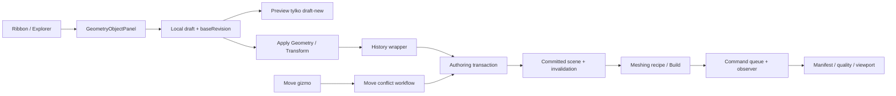

# Stan obecny: przepływy i macierz funkcjonalna

## Wniosek architektoniczny

Control Room ma już rozbudowaną infrastrukturę authoringu: scenę z rewizją, transakcje, sesję edycji inspektora, historię semantyczną, komendy, zasoby i osobne mechanizmy meshu. Nie jest jednak kompletnym precyzyjnym modelerem. Szczególnie niewyrównana jest jakość integracji: polityka meshu ma zabezpieczenia, których brakuje w równoległej ścieżce manipulacji geometrią. Podstawą tej oceny są [S01: `GeometryObjectPanel.tsx`](https://github.com/MateuszZelent/fullmag/blob/2a3c6becb9c7e111ae1497ec0cd9ac9576acba95/apps/control-room/src/modules/inspector/panels/GeometryObjectPanel.tsx), [S03: `InspectorEditSession.tsx`](https://github.com/MateuszZelent/fullmag/blob/2a3c6becb9c7e111ae1497ec0cd9ac9576acba95/apps/control-room/src/modules/inspector/InspectorEditSession.tsx), [S18: `ObjectMeshPolicyPanel.tsx`](https://github.com/MateuszZelent/fullmag/blob/2a3c6becb9c7e111ae1497ec0cd9ac9576acba95/apps/control-room/src/modules/inspector/panels/ObjectMeshPolicyPanel.tsx), [S20: `geometryLifecycleCommandContributions.ts`](https://github.com/MateuszZelent/fullmag/blob/2a3c6becb9c7e111ae1497ec0cd9ac9576acba95/apps/control-room/src/kernel/authoring/geometryLifecycleCommandContributions.ts) i [S21: `authoringHistoryMutation.ts`](https://github.com/MateuszZelent/fullmag/blob/2a3c6becb9c7e111ae1497ec0cd9ac9576acba95/apps/control-room/src/kernel/authoring/authoringHistoryMutation.ts).

Nie rekomenduję zastąpienia całego frontendu. Rekomenduję ujednolicenie kontraktów modelu i narzędzi, a następnie przebudowę fragmentów widoku nad istniejącym kernelem. Sama wymiana układu ikon nie rozwiąże F01–F08.

## Mapa przepływu obecnego

Diagram pokazuje różnicę ścieżki historii, nie pełną hierarchię wszystkich komponentów. Odpowiedniki: [S01: `GeometryObjectPanel.tsx`](https://github.com/MateuszZelent/fullmag/blob/2a3c6becb9c7e111ae1497ec0cd9ac9576acba95/apps/control-room/src/modules/inspector/panels/GeometryObjectPanel.tsx), [S07: `objectTranslationMutation.ts`](https://github.com/MateuszZelent/fullmag/blob/2a3c6becb9c7e111ae1497ec0cd9ac9576acba95/apps/control-room/src/kernel/authoring/objectTranslationMutation.ts), [S08: `objectMoveConflictWorkflow.ts`](https://github.com/MateuszZelent/fullmag/blob/2a3c6becb9c7e111ae1497ec0cd9ac9576acba95/apps/control-room/src/kernel/authoring/objectMoveConflictWorkflow.ts), [S09: `Viewport3DObjectMoveInteraction.tsx`](https://github.com/MateuszZelent/fullmag/blob/2a3c6becb9c7e111ae1497ec0cd9ac9576acba95/apps/control-room/src/modules/viewport-3d/Viewport3DObjectMoveInteraction.tsx), [S20: `geometryLifecycleCommandContributions.ts`](https://github.com/MateuszZelent/fullmag/blob/2a3c6becb9c7e111ae1497ec0cd9ac9576acba95/apps/control-room/src/kernel/authoring/geometryLifecycleCommandContributions.ts).

## Macierz dostępności

| Funkcja | Stan w sprawdzonym kodzie | Ocena i zakres |
|---|---|---|
| Box, Cylinder, Sphere | Formularze i serializer istnieją | Zachować; naprawić cykl edycji i parsowanie. |
| Thin Film / Microstrip | Akcje ribbonu obecne | Nie zakładać, że każdy preset jest tym samym prymitywem lub ma tę samą rolę. |
| ArchWaveguide | Obsługiwany przez model formularza | Nie stwierdzono dedykowanej aktywnej akcji Create w czytanym ribbonie. |
| Ellipsoid, Ring, Cone, Tube itd. | Akcje disabled | Nie prezentować jako działających możliwości. |
| Union/Subtract/Intersect | Akcje disabled | Specjalny preview Box–Cylinder Difference w rendererze nie jest ogólnym edytorem CSG. |
| Import STL na starcie | Jawnie unavailable | Backend summary STL istnieje; brak pełnego potwierdzonego workflow UI. |
| Translation Type-In | Implementacja istnieje | Problemy baseline, konfliktu i walidacji. |
| Move gizmo | Trzy osie, jeden magnetyczny obiekt | Różnice historii, sesji i obsługi błędów; bbox preview. |
| Rotate / Scale | Pola oraz narzędzia disabled | Luka funkcjonalna; wymagany kontrakt end-to-end. |
| Snap / coordinate frames / pivot | Snap disabled; brak kompletnego kontraktu w badanym Move | Projekt docelowy w osobnym rozdziale. |
| Apply/Revert wspólne | Infrastruktura istnieje | Formularz geometrii równolegle posiada lokalne przyciski o innych regułach. |
| FEM object mesh policy | Zaawansowany edytor istnieje | Presety, sizing, thin-film, quality, pola zaawansowane; nie pisać od nowa. |
| Apply & Build Mesh | Istnieje | Zapis przed budową, session fence i blokada równoległych kliknięć. |
| Mesh confirmation | Istnieje | Snapshot i policy diff; kontrola bieżącej rewizji. |
| Obserwacja zadania | Istnieje | Pending/disconnected/publication-unconfirmed; ochrona przed duplikatem build. |
| Mesh quality / history | Istnieją | Rozproszone po panelach; ujednolicić wejścia i identity selection. |
| FDM Build Grid | Akcja istnieje | Nie jest FEM tetrahedralization. |
| FDM grid inspection | Istnieje | Fingerprint, maska, regiony, stary snapshot komórki; to dobry wzorzec. |

Źródła macierzy: [S01: `GeometryObjectPanel.tsx`](https://github.com/MateuszZelent/fullmag/blob/2a3c6becb9c7e111ae1497ec0cd9ac9576acba95/apps/control-room/src/modules/inspector/panels/GeometryObjectPanel.tsx), [S02: `geometryObjectPanelModel.ts`](https://github.com/MateuszZelent/fullmag/blob/2a3c6becb9c7e111ae1497ec0cd9ac9576acba95/apps/control-room/src/modules/inspector/panels/geometryObjectPanelModel.ts), [S12: `importFormats.ts`](https://github.com/MateuszZelent/fullmag/blob/2a3c6becb9c7e111ae1497ec0cd9ac9576acba95/apps/control-room/src/modules/start/model/importFormats.ts), [S13: `assets.rs`](https://github.com/MateuszZelent/fullmag/blob/2a3c6becb9c7e111ae1497ec0cd9ac9576acba95/crates/fullmag-api/src/assets.rs), [S15: `ribbonContributions.tsx`](https://github.com/MateuszZelent/fullmag/blob/2a3c6becb9c7e111ae1497ec0cd9ac9576acba95/apps/control-room/src/modules/ribbon/ribbonContributions.tsx), [S16: `MeshDetailsPanel.tsx`](https://github.com/MateuszZelent/fullmag/blob/2a3c6becb9c7e111ae1497ec0cd9ac9576acba95/apps/control-room/src/modules/inspector/panels/MeshDetailsPanel.tsx), [S18: `ObjectMeshPolicyPanel.tsx`](https://github.com/MateuszZelent/fullmag/blob/2a3c6becb9c7e111ae1497ec0cd9ac9576acba95/apps/control-room/src/modules/inspector/panels/ObjectMeshPolicyPanel.tsx), [S19: `MeshBuildDialog.tsx`](https://github.com/MateuszZelent/fullmag/blob/2a3c6becb9c7e111ae1497ec0cd9ac9576acba95/apps/control-room/src/modules/overlay/MeshBuildDialog.tsx), [S20: `geometryLifecycleCommandContributions.ts`](https://github.com/MateuszZelent/fullmag/blob/2a3c6becb9c7e111ae1497ec0cd9ac9576acba95/apps/control-room/src/kernel/authoring/geometryLifecycleCommandContributions.ts), [S22: `viewport3dPrimitiveModel.ts`](https://github.com/MateuszZelent/fullmag/blob/2a3c6becb9c7e111ae1497ec0cd9ac9576acba95/apps/control-room/src/modules/viewport-3d/viewport3dPrimitiveModel.ts), [S23: `FdmGridInspectorPanel.tsx`](https://github.com/MateuszZelent/fullmag/blob/2a3c6becb9c7e111ae1497ec0cd9ac9576acba95/apps/control-room/src/modules/inspector/panels/fdm-grid/FdmGridInspectorPanel.tsx).

## Ścieżka A — nowy prymityw

Akcja tworzenia otwiera builder. Formularz przygotowuje lokalne parametry i translację, a overlay publikuje nowy draft. Create tworzy obiekt przez transakcję z base_revision i odwołaniami do materiału/regionu. Następuje publikacja zatwierdzonej sceny i selekcja nowego obiektu. To jest właściwy kierunek: samo wpisanie wymiaru nie powinno modyfikować backendu. [S01: `GeometryObjectPanel.tsx`](https://github.com/MateuszZelent/fullmag/blob/2a3c6becb9c7e111ae1497ec0cd9ac9576acba95/apps/control-room/src/modules/inspector/panels/GeometryObjectPanel.tsx), [S02: `geometryObjectPanelModel.ts`](https://github.com/MateuszZelent/fullmag/blob/2a3c6becb9c7e111ae1497ec0cd9ac9576acba95/apps/control-room/src/modules/inspector/panels/geometryObjectPanelModel.ts), [S06: `geometryLifecycleCommands.ts`](https://github.com/MateuszZelent/fullmag/blob/2a3c6becb9c7e111ae1497ec0cd9ac9576acba95/apps/control-room/src/kernel/authoring/geometryLifecycleCommands.ts).

Punkty kontrolne: czy nowe primitive kind nie dziedziczy draftId i wartości po poprzednim typie; czy materiał/region są poprawnymi identyfikatorami, a nie jedynie wolnym tekstem; czy zamknięcie lub zmiana selekcji daje Apply/Discard/Cancel; czy Create przed uzyskaniem rewizji sceny jest zablokowane. Dwa ostatnie pytania nie mogą być rozstrzygane jedynie przez disabled lokalnego przycisku.

## Ścieżka B — edycja istniejącego obiektu

Po selekcji obiektu baseDraft pochodzi ze sceny, lecz dirty state jest lokalny. Można edytować geometrię i translację. Wspólna stopka odmawia równoczesnego Apply obu grup; lokalne przyciski pozwalają wywołać częściowe zapisy. Po ACK nie następuje odpowiednia wymiana baseline formularza, co opisują F01–F03. [S01: `GeometryObjectPanel.tsx`](https://github.com/MateuszZelent/fullmag/blob/2a3c6becb9c7e111ae1497ec0cd9ac9576acba95/apps/control-room/src/modules/inspector/panels/GeometryObjectPanel.tsx), [S03: `InspectorEditSession.tsx`](https://github.com/MateuszZelent/fullmag/blob/2a3c6becb9c7e111ae1497ec0cd9ac9576acba95/apps/control-room/src/modules/inspector/InspectorEditSession.tsx).

Docelowa jednostka edycji to intencja użytkownika, np. „zmień promień na 80 nm i przesuń środek na X=300 nm”, a nie arbitralna granica dwóch przycisków. Oddzielne narzędzia są dopuszczalne, lecz muszą świadomie tworzyć oddzielne intencje i aktualizować bazę po każdym zatwierdzeniu.

## Ścieżka C — gest viewportu

Ribbon aktywuje Move dla wybranego magnetycznego scene-object. Warstwa viewportu sprawdza aktualną aktywację i buduje gizmo. Pointermove działa lokalnie, a pointerup wywołuje jeden commit. To ograniczenie liczby requestów podczas ruchu jest korzystne i powinno pozostać. Escape, pointercancel i utrata capture mają obsługę czyszczenia; testy helpera nie są puste. [S09: `Viewport3DObjectMoveInteraction.tsx`](https://github.com/MateuszZelent/fullmag/blob/2a3c6becb9c7e111ae1497ec0cd9ac9576acba95/apps/control-room/src/modules/viewport-3d/Viewport3DObjectMoveInteraction.tsx), [S10: `MoveObjectGizmo.tsx`](https://github.com/MateuszZelent/fullmag/blob/2a3c6becb9c7e111ae1497ec0cd9ac9576acba95/apps/control-room/src/modules/viewport-3d/MoveObjectGizmo.tsx), [S11: `MoveObjectGizmo.test.tsx`](https://github.com/MateuszZelent/fullmag/blob/2a3c6becb9c7e111ae1497ec0cd9ac9576acba95/apps/control-room/src/modules/viewport-3d/MoveObjectGizmo.test.tsx), [S14: `ribbonCommands.ts`](https://github.com/MateuszZelent/fullmag/blob/2a3c6becb9c7e111ae1497ec0cd9ac9576acba95/apps/control-room/src/modules/ribbon/ribbonCommands.ts).

Problemem nie jest całkowity brak lifecycle, tylko brak domknięcia: async ACK, następny gest, semantyczna historia, session fence i error UI. Nowy ToolController musi zachować istniejące właściwe zachowania anulowania, zamiast je utracić przy podmianie manipulatora.

## Ścieżka D — parametry i ponowna budowa FEM

ObjectMeshPolicyPanel potrafi odróżnić authored override od wartości effective. Gdy draft jest dirty, Build używa najpierw Apply. Przy zapisie i budowie zachowywane jest sprawdzenie bieżącej sesji. Panel informuje, że poprzedni solver mesh jest stale do ukończenia budowy. [S18: `ObjectMeshPolicyPanel.tsx`](https://github.com/MateuszZelent/fullmag/blob/2a3c6becb9c7e111ae1497ec0cd9ac9576acba95/apps/control-room/src/modules/inspector/panels/ObjectMeshPolicyPanel.tsx).

MeshBuildDialog przechwytuje snapshot przed budową, porównuje polityki i odmawia potwierdzenia nieaktualnego snapshotu. Opisuje też reinicjalizację magnetyzacji. Komendy zachowują tożsamość intencji i obserwują opublikowaną rewizję. Nie należy zastępować tego prostym `await fetch(); toast('success')`. [S19: `MeshBuildDialog.tsx`](https://github.com/MateuszZelent/fullmag/blob/2a3c6becb9c7e111ae1497ec0cd9ac9576acba95/apps/control-room/src/modules/overlay/MeshBuildDialog.tsx), [S20: `geometryLifecycleCommandContributions.ts`](https://github.com/MateuszZelent/fullmag/blob/2a3c6becb9c7e111ae1497ec0cd9ac9576acba95/apps/control-room/src/kernel/authoring/geometryLifecycleCommandContributions.ts).

Otwarte punkty integracyjne: pierwszy build bez poprzedniego manifestu, porównanie identity jakości i topologii, zgodność statusu stale w viewportcie i inspektorze, wybór elementu po remeshu oraz recovery przy utraconym ACK. Część to ryzyka R, a nie potwierdzone awarie całego procesu.

## Ścieżka E — FDM

FDM object mesh jest w badanym panelu opisany jako execution-plan owned, a nie osobny tetrahedral mesh. Inspektor pokazuje rzeczywistą siatkę, membership, regiony i fingerprint. Wyboru komórki ze starego snapshotu nie klasyfikuje jako bieżącej bez dowodu. To wzorzec bezpieczniejszy niż sam elementIndex w FEM. [S18: `ObjectMeshPolicyPanel.tsx`](https://github.com/MateuszZelent/fullmag/blob/2a3c6becb9c7e111ae1497ec0cd9ac9576acba95/apps/control-room/src/modules/inspector/panels/ObjectMeshPolicyPanel.tsx), [S23: `FdmGridInspectorPanel.tsx`](https://github.com/MateuszZelent/fullmag/blob/2a3c6becb9c7e111ae1497ec0cd9ac9576acba95/apps/control-room/src/modules/inspector/panels/fdm-grid/FdmGridInspectorPanel.tsx).

Docelowy przycisk powinien nazywać się Build Grid i prowadzić do ustawień dyskretyzacji właściciela planu. Nie należy udawać, że hmin/hmax Gmsh zmienia spacing FDM. Wyświetlane próbki wizualizacji nie są liczbą komórek solvera.

## Co zachować bez regresji

Zachować kernel zasobów i ich tożsamość sesji, command registry, rozdzielenie FEM/FDM, historię authoringu, istniejący model obserwacji meshu, policy/effective diff, quality/history oraz nowy HUD. Ujednolicać ich użycie zamiast tworzyć równoległe mechanizmy „tylko dla nowego buildera”. Specyfikacja poniżej nie zakłada wymiany navbaru, całego layoutu ani modułu analiz.
