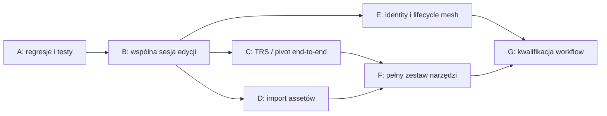

# Plan wdrożenia i kryteria dopuszczenia

## 1. Kolejność, nie przepisanie aplikacji

Priorytetem jest spójność modelu, a dopiero później rozszerzanie zestawu narzędzi. Wprowadzenie obrotu lub importu na rozbieżnych ścieżkach Apply zwiększy liczbę stanów błędnych. Zachować istniejący kernel, routing inspektorów, rejestr komend, historię i pipeline meshu; wydzielać wspólne kontrakty z obecnego kodu.

Każdy pakiet powinien być oddzielną zmianą reviewable, z testem demonstrującym wcześniejszy błąd i testem zachowania prawidłowych ścieżek. Nie łączyć szerokiego porządkowania stylistycznego z naprawą rewizji.

## 2. Pakiety pracy

| Pakiet | Ustalenia | Konkretna zmiana | Warunek zakończenia |
|---|---|---|---|
| A1. Baseline i konflikt formularza | F01, F02, F26 | GeometryObjectPanel: wspólny reducer identity/baseline/ACK/conflict; uwzględnić kind/session/draftId; reset stanów terminalnych. | Dwie kolejne edycje bez sztucznego 409; retry i Revert usuwają właściwy konflikt; obcy ACK nie czyści nowego draftu. |
| A2. Mutacje Move | F04–F07, F16 | Przeprowadzić Move przez history mutation z capture fence; operationId/gestureId; no-op epsilon z jednostką i zasadą; jawny error presenter. | Jeden Undo dla gestu; zero requestów podczas move; zero mutacji dla bezruchu; błąd i late ACK nie usuwają nowej edycji. |
| A3. Walidacja i render fallback | F09, F12, F17, F18 | Parser rozróżnia empty/invalid/finite; unsupported geometries read-only; validation state zamiast domyślnego „no issues”; cylinder fallback. | Puste XYZ nie staje się zerem; niesprawdzona walidacja nie jest zielona; znane cylindry mają poprawne bounds. |
| B1. Jedna sesja obiektu | F03, F08, F13 | Wydzielić ObjectEditSession; numeric inspector i gizmo korzystają z jednego draftu; three-way rebase i atomic edit. | Jedna intencja wymiar+placement; jeden wpis historii; preview i Apply mają identyczną semantykę. |
| B2. Capability-driven routing | F10, F12, F14, F24 | Jeden model capabilities konsumowany przez ribbon, inspector, command registry i viewport; wspólny disabled reason. | Brak aktywnej kontrolki, której serializer nie obsługuje; brak sprzecznych powodów blokady. |
| C1. Geometry transform contract | F10 | Rozszerzenie canonical scene/IR/serializacji/evaluators o TRS; quaternion order, pivot, bounds i walidacja. | Parzystość world geometry w UI i backendzie dla zestawu fixture; stabilny round-trip save/load. |
| C2. Pivots i narzędzia | F14, F15 | World/Local, absolute/delta, plane handles, screen-stable gizmo, snap, numeric entry; jawne ograniczenia shear/mirror. | Ray geometry, ortho/perspective, cancel, keyboard, unit tests transformów i testy przeglądarkowe. |
| D1. Import assetu | F11 | Upload/staging, hash, units, preview, raport checks, commit do sceny; source i object scale rozdzielone. | ASCII/binary STL działają; unknown checks nie udają pass; brak obiektu po Cancel. |
| D2. Reimport i selections | F11, F12 | Wersjonowanie źródła, jawny repair diff, rebind semantic selection, stale descendants. | Reimport nie przenosi regionów po losowym triangle ordinal; source archive odtwarzalny. |
| E1. Mesh identity/readiness | F19–F21, F28 | Wspólny freshness resolver i artifact identity; pierwszy build absent; jakość i topologia wersjonowane razem. | Testy future/missing/mixed revision; first-build; klik starego elementu nie trafia w nowy. |
| E2. Mesh observation | F22 | Lookup statusu po client_intent_id lub paginacja/reconciliation z jawną granicą kompletności. | Lost ACK po wielu buildach nadal odnajduje właściwy job; nigdy duplicate submit. |
| E3. Historia i inspekcja | F23, F27 | History tab z realnymi zdarzeniami; JSON do Diagnostics; degraded Undo oznaczone; mesh restore jako draft. | UI odróżnia recipe restore, geometry undo i aktywację artefaktu. |
| F1. Integracja ekranów | F13, F14, F24, F25 | Wdrożyć makiety nad istniejącym shellem; wyodrębnić mniejsze komponenty po stabilizacji kontraktów. | Wszystkie ścieżki wejścia wywołują te same komendy i respektują te same blokady. |
| G1. Kwalifikacja | wszystkie | Scenariusze z dokumentu 08, zapis dowodów, profile wydajności i macierz FEM/FDM. | Brak otwartych P1 bez jawnej decyzji release; wszystkie deklarowane funkcje mają dowód E2E. |

## 3. Dokładne punkty integracji

A1/A3/B1 zaczynać od [S01: `GeometryObjectPanel.tsx`](https://github.com/MateuszZelent/fullmag/blob/2a3c6becb9c7e111ae1497ec0cd9ac9576acba95/apps/control-room/src/modules/inspector/panels/GeometryObjectPanel.tsx) i [S02: `geometryObjectPanelModel.ts`](https://github.com/MateuszZelent/fullmag/blob/2a3c6becb9c7e111ae1497ec0cd9ac9576acba95/apps/control-room/src/modules/inspector/panels/geometryObjectPanelModel.ts). Reużyć kontrakt rejestracji z [S03: `InspectorEditSession.tsx`](https://github.com/MateuszZelent/fullmag/blob/2a3c6becb9c7e111ae1497ec0cd9ac9576acba95/apps/control-room/src/modules/inspector/InspectorEditSession.tsx); nie tworzyć drugiej stopki z niezależnym stanem. Parent identity i guard sprawdzić w [S04: `InspectorModule.tsx`](https://github.com/MateuszZelent/fullmag/blob/2a3c6becb9c7e111ae1497ec0cd9ac9576acba95/apps/control-room/src/modules/inspector/InspectorModule.tsx). Nie polegać wyłącznie na React key do naprawy operacji w locie.

A2/C2 integrować w [S09: `Viewport3DObjectMoveInteraction.tsx`](https://github.com/MateuszZelent/fullmag/blob/2a3c6becb9c7e111ae1497ec0cd9ac9576acba95/apps/control-room/src/modules/viewport-3d/Viewport3DObjectMoveInteraction.tsx), [S10: `MoveObjectGizmo.tsx`](https://github.com/MateuszZelent/fullmag/blob/2a3c6becb9c7e111ae1497ec0cd9ac9576acba95/apps/control-room/src/modules/viewport-3d/MoveObjectGizmo.tsx), [S08: `objectMoveConflictWorkflow.ts`](https://github.com/MateuszZelent/fullmag/blob/2a3c6becb9c7e111ae1497ec0cd9ac9576acba95/apps/control-room/src/kernel/authoring/objectMoveConflictWorkflow.ts), [S07: `objectTranslationMutation.ts`](https://github.com/MateuszZelent/fullmag/blob/2a3c6becb9c7e111ae1497ec0cd9ac9576acba95/apps/control-room/src/kernel/authoring/objectTranslationMutation.ts) i [S21: `authoringHistoryMutation.ts`](https://github.com/MateuszZelent/fullmag/blob/2a3c6becb9c7e111ae1497ec0cd9ac9576acba95/apps/control-room/src/kernel/authoring/authoringHistoryMutation.ts). Usunięcie direct mutation z Move jest ważniejsze niż zamiana cylindra-osi na ładniejszą strzałkę. Nowy adapter manipulatora może używać biblioteki, lecz nie może posiadać własnej historii ani zapisywać Three.Object3D jako modelu fizycznego.

E1/E2 integrować z [S17: `useMeshDetailsModel.ts`](https://github.com/MateuszZelent/fullmag/blob/2a3c6becb9c7e111ae1497ec0cd9ac9576acba95/apps/control-room/src/modules/inspector/panels/mesh-details/useMeshDetailsModel.ts), [S19: `MeshBuildDialog.tsx`](https://github.com/MateuszZelent/fullmag/blob/2a3c6becb9c7e111ae1497ec0cd9ac9576acba95/apps/control-room/src/modules/overlay/MeshBuildDialog.tsx), [S20: `geometryLifecycleCommandContributions.ts`](https://github.com/MateuszZelent/fullmag/blob/2a3c6becb9c7e111ae1497ec0cd9ac9576acba95/apps/control-room/src/kernel/authoring/geometryLifecycleCommandContributions.ts), [S22: `viewport3dPrimitiveModel.ts`](https://github.com/MateuszZelent/fullmag/blob/2a3c6becb9c7e111ae1497ec0cd9ac9576acba95/apps/control-room/src/modules/viewport-3d/viewport3dPrimitiveModel.ts). Zachować sprawdzenie nowej opublikowanej rewizji z [S06: `geometryLifecycleCommands.ts`](https://github.com/MateuszZelent/fullmag/blob/2a3c6becb9c7e111ae1497ec0cd9ac9576acba95/apps/control-room/src/kernel/authoring/geometryLifecycleCommands.ts). [S18: `ObjectMeshPolicyPanel.tsx`](https://github.com/MateuszZelent/fullmag/blob/2a3c6becb9c7e111ae1497ec0cd9ac9576acba95/apps/control-room/src/modules/inspector/panels/ObjectMeshPolicyPanel.tsx) ma już session fence i Apply & Build; przenieść wzorce do wspólnych funkcji dopiero po zabezpieczeniu obecnych testów.

D1 rozpoczynać od oddzielenia klasyfikacji formatu [S12: `importFormats.ts`](https://github.com/MateuszZelent/fullmag/blob/2a3c6becb9c7e111ae1497ec0cd9ac9576acba95/apps/control-room/src/modules/start/model/importFormats.ts) od realizacji assetu. [S13: `assets.rs`](https://github.com/MateuszZelent/fullmag/blob/2a3c6becb9c7e111ae1497ec0cd9ac9576acba95/crates/fullmag-api/src/assets.rs) jest summary parserem; rozbudowa importu nie może uznawać jego triangle_count/bounds za certyfikat zamkniętej geometrii. Projekt endpointów musi być uzgodniony z istniejącą ścieżką importu/meshing Python; nie deklaruję, że sam frontend rozwiąże tę część.

## 4. Kontrakty wymagające decyzji przed implementacją

Ustalić: dopuszczalne transformacje dla każdej rodziny geometrii i lane; czy pivot jest parametrem konstrukcyjnym czy tylko metadanymi narzędzia; czy obrót obiektu obraca lokalne osie materiału i initial texture; politykę transferu magnetyzacji po remeshu; zakres Build Selected; zachowanie geometry editing podczas aktywnego solvera; format zachowywania importowanych assetów w projekcie.

Decyzje zapisać jako ADR z przykładami wejście/wyjście i testami kontraktu. Nie używać „jak w 3ds Max” jako specyfikacji jednostek, kolejności rotacji czy fizyki materiału.

## 5. Bramka wydania

**Warunek minimalny poprawności authoringu:** powtarzalne Apply, jednolity Undo, session isolation, brak utraty draftu przez spóźniony ACK, poprawne stany błędów i brak akceptowania pustego wymiaru. Ustalenia R przechodzą w resolved albo confirmed po konkretnym teście; nie zamykać ich samą zmianą opisu.

**Warunek deklarowania Rotate/Scale/Import:** poprawny round-trip do kanonicznego modelu i zgodna realizacja FEM/FDM tam, gdzie capability deklaruje wsparcie. Do tego czasu narzędzie może pozostać disabled z prawdziwym powodem. Nie uruchamiać go jako wyłącznie wizualnego obrotu.

**Warunek deklarowania niezawodnego rebuild:** pierwszy build od pustej sceny, rebuild po geometrii i polityce, retained old mesh po błędzie, reconnect bez duplikatu oraz tożsamość quality/topology/selection. Rendered i backend completed muszą być widocznymi osobnymi faktami.

Ten raport nie jest certyfikatem release. Najpierw naprawić A1/A2, następnie ujednolicić authoring i identity; dopiero na tym fundamencie rozszerzyć narzędzia i import.
