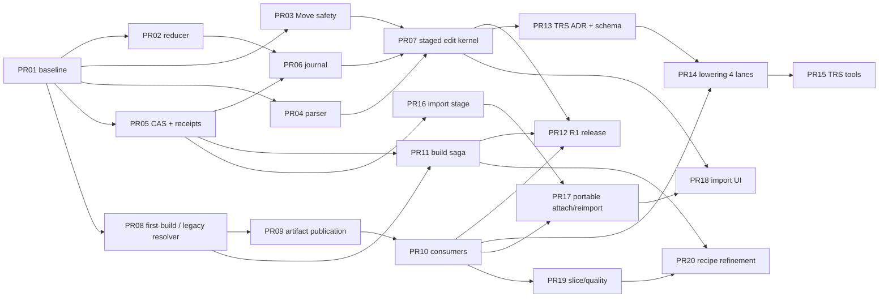

# Plan dostaw, pliki i bramki — v2

Nie są to utworzone PR-y. Identyfikatory PR01–PR20 oznaczają propozycje małych zmian do review. Role właścicieli są wymaganiami obsady, nie przydziałem konkretnej osoby. Rekomendowane ADR z D00 muszą zostać zaakceptowane przed zależnym etapem. Zakres: geometry/mesh authoring, nie cały Control Room.

## 1. Granica release

| Funkcja | Release | Zależności | Odbiór |
|---|---|---|---|
| Spójny Apply geometry+translation | R1 | PR02/05/06/07 | T01/T02/T51/T52 |
| Powtarzalne Create, Revert, konflikty, późny ACK | R1 | PR02/04/06/07 | T01/T03–T07/T53–T55 |
| Move myszą, single object - immediate commit safety | R0 | PR03 | T18 (R0)/T19 (R0)/T20 (R0)/T21/T22/T26 (R0) |
| Move numeryczny i myszą, single object - staged draft + Apply | R1 | PR04/07 | T18 (R1)/T19 (R1)/T20 (R1)/T21 (R1)/T22 (R1)/T25/T26 (R1)/T56 |
| First-build, wspólna aktualność, Build Selected scope | R1 | PR08–PR12 | T33–T44/T58/T60 |
| Portable recovery receipts zwykłych mutacji | R1 | PR05/06 | T53/T65; brak pełnej trwałej historii Undo |
| Numeric Rotate/Scale, canonical pivot, World/Local | R2-T | PR13–PR15 | T13–T17/T23/T64 |
| Snap translation/rotation/scale | R2-T | PR15 | T24; OFF domyślnie |
| Anchor center/bottom/custom i ustawienie Position | R2-T | PR13/15 | T14/T15; zero pierwotnych pól transformu nie dodawane ponownie |
| STL staged import, source units, construction-only | R2-I | PR16–PR18 | T27–T31/T72 |
| STL occupancy/volume i reimport | R2-I | PR17/18 + kwalifikacja właściwej lane | T29/T32/T59/T64 |
| Custom clipping plane + per-element quality | R2-Q | PR19 | T43–T45/T69 |
| Quality refinement przez receptę | R2-Q | PR20 | T35/T43/T69 |
| Wieloselekcja do inspekcji | R3 | osobny selection contract | Nie aktywować multi-write przez tablicę ID |
| Wieloobiektowe Move/Rotate/Scale, duplicate/array | R3 | osobna atomowość i historia zbioru | Nowy backend kontrakt i test all-or-nothing |
| Align do obiektu/ściany | R3 | stabilne face/anchor selection, multiobject policy | Brak udawania poprzez bbox innych obiektów |
| Dowolne authored workplanes i workplane snapping | R3 | frame assets + lifetime/export | R1 ma tylko istniejące widoki XY/XZ/YZ, nie nowe parametric planes |
| Parametryczne expressions i dependency graph | R3 | parser typowany + jednostki + cykle + Python roundtrip | R1/R2 akceptuje liczby z jednostkami, nie równania |
| Ogólne CSG/history of features | R3 | topology naming + geometry kernel contracts | Zachować już istniejący ograniczony Difference; nie rozszerzać przez sam UI |
| Hierarchia parent/child, shear, mirror | R3 | affine/frame/physics ADR | T16/T17 w R1/R2 odmowa |
| Porównanie zbieżności meshu i projektowanie transferu stanu | R3 | obserwable + serie runów + nota naukowa | Nie nazywać histogramu elementów testem zbieżności |

R0 nie ustanawia drugiego publicznego trybu interakcji. R0 jest oknem wewnętrznych poprawek i testów aktualnego kodu. Pierwszy publiczny R1 ma wyłącznie pointerup→draft, Apply→mutation. Biblioteki ani rozdzielenie PR nie są zgodą na utrzymanie niespójnych granic transakcji.

## 2. Graf zależności

PR08 może wejść bez ukończonego PR07; nie trzeba czekać na TRS/import. PR02 produkuje reducer docelowej usługi, a PR07 migruje ownership i konsumentów — nie pisze nowego reducer’a. PR16 może rozwijać backend stage równolegle z PR13, ale jego UI nie obchodzi wspólnego Apply ani asset receipt.

## 3. Małe PR-y

### PR01 · Dowody wejściowe i baseline · R0

**Owner:** frontend QA / release. **Mapowanie v1:** A0. **Depends:** —.

**Pliki/granice:** `verification recipes w zatwierdzonym storage; bez modyfikacji runtime`.

**Wejściowy kontrakt:** Zamrożony commit, środowisko i oryginalne reprodukcje; reguły worktree i zakaz kompilacji testów odczytane.

**Odbiór:** Reproduce / not-reproduced / blocked per test; baseline numbers pozostają null do pomiaru. Właściciel zatwierdza profile. Testy: T01, T02, T18, T33, T49, T55.

**Wycofanie / migracja:** Nie dotyka aplikacji; usunąć wyłącznie output zadania według governance.

Źródła punktów integracji: [S01: `GeometryObjectPanel.tsx`](https://github.com/MateuszZelent/fullmag/blob/2a3c6becb9c7e111ae1497ec0cd9ac9576acba95/apps/control-room/src/modules/inspector/panels/GeometryObjectPanel.tsx), [S09: `Viewport3DObjectMoveInteraction.tsx`](https://github.com/MateuszZelent/fullmag/blob/2a3c6becb9c7e111ae1497ec0cd9ac9576acba95/apps/control-room/src/modules/viewport-3d/Viewport3DObjectMoveInteraction.tsx), [S17: `useMeshDetailsModel.ts`](https://github.com/MateuszZelent/fullmag/blob/2a3c6becb9c7e111ae1497ec0cd9ac9576acba95/apps/control-room/src/modules/inspector/panels/mesh-details/useMeshDetailsModel.ts), [S31: `frontend.md`](https://github.com/MateuszZelent/fullmag/blob/2a3c6becb9c7e111ae1497ec0cd9ac9576acba95/.agents/instructions/frontend.md), [S32: `AGENTS.md`](https://github.com/MateuszZelent/fullmag/blob/2a3c6becb9c7e111ae1497ec0cd9ac9576acba95/AGENTS.md).

### PR02 · Reducer baseline, identity i ACK · R0

**Owner:** frontend authoring. **Mapowanie v1:** A1. **Depends:** PR01.

**Pliki/granice:** `kernel/authoring/object-edit/objectEditReducer.ts [nowy]`; `modules/inspector/panels/GeometryObjectPanel.tsx`.

**Wejściowy kontrakt:** Semantyczne grupy i scoped identity z D04. Nowy reducer od początku publiczny przez kernel, bez prywatnego store Inspectora.

**Odbiór:** Dwie edycje, conflict/Revert, ACK A→B, późniejszy rawText; stabilny panel. Ten sam reducer zostanie użyty w PR07. Testy: T01, T03, T04, T05, T06, T07, T54, T55.

**Wycofanie / migracja:** Adapter starego panelu pozostaje właścicielem integracji; revert kodu bez zmiany modelu.

Źródła punktów integracji: [S01: `GeometryObjectPanel.tsx`](https://github.com/MateuszZelent/fullmag/blob/2a3c6becb9c7e111ae1497ec0cd9ac9576acba95/apps/control-room/src/modules/inspector/panels/GeometryObjectPanel.tsx), [S02: `geometryObjectPanelModel.ts`](https://github.com/MateuszZelent/fullmag/blob/2a3c6becb9c7e111ae1497ec0cd9ac9576acba95/apps/control-room/src/modules/inspector/panels/geometryObjectPanelModel.ts), [S03: `InspectorEditSession.tsx`](https://github.com/MateuszZelent/fullmag/blob/2a3c6becb9c7e111ae1497ec0cd9ac9576acba95/apps/control-room/src/modules/inspector/InspectorEditSession.tsx), [S04: `InspectorModule.tsx`](https://github.com/MateuszZelent/fullmag/blob/2a3c6becb9c7e111ae1497ec0cd9ac9576acba95/apps/control-room/src/modules/inspector/InspectorModule.tsx).

### PR03 · Zabezpieczenie obecnego Move · R0

**Owner:** frontend viewport. **Mapowanie v1:** A2. **Depends:** PR01.

**Pliki/granice:** `modules/viewport-3d/MoveObjectGizmo.tsx`; `modules/viewport-3d/Viewport3DObjectMoveInteraction.tsx`; `kernel/authoring/objectMoveConflictWorkflow.ts`.

**Wejściowy kontrakt:** R0 jest wewnętrznym hotfiksem. Zachowuje istniejące zakończenie gestu, lecz fence/serializacja i error handling są obowiązkowe.

**Odbiór R0:** PR03 utrzymuje immediate commit, serializuje zapisy i blokuje BeginGesture B do terminalnego wyniku A; no-op nie wysyła mutacji ani nie tworzy historii; błędy commitu wyzwolonego przez pointerup są przechwycone i widoczne, bez unhandled rejection; błąd capture historii jest jawnie oznaczony jako degraded. Testy: T18 (R0), T19 (R0), T20 (R0), T21, T22, T26 (R0). Ten hotfix nie kwalifikuje staged R1.

**Wycofanie / migracja:** Nowe narzędzie można wyłączyć, pozostawiając naprawiony numeric Inspector; PR07 usuwa immediate compatibility path.

Źródła punktów integracji: [S07: `objectTranslationMutation.ts`](https://github.com/MateuszZelent/fullmag/blob/2a3c6becb9c7e111ae1497ec0cd9ac9576acba95/apps/control-room/src/kernel/authoring/objectTranslationMutation.ts), [S08: `objectMoveConflictWorkflow.ts`](https://github.com/MateuszZelent/fullmag/blob/2a3c6becb9c7e111ae1497ec0cd9ac9576acba95/apps/control-room/src/kernel/authoring/objectMoveConflictWorkflow.ts), [S09: `Viewport3DObjectMoveInteraction.tsx`](https://github.com/MateuszZelent/fullmag/blob/2a3c6becb9c7e111ae1497ec0cd9ac9576acba95/apps/control-room/src/modules/viewport-3d/Viewport3DObjectMoveInteraction.tsx), [S10: `MoveObjectGizmo.tsx`](https://github.com/MateuszZelent/fullmag/blob/2a3c6becb9c7e111ae1497ec0cd9ac9576acba95/apps/control-room/src/modules/viewport-3d/MoveObjectGizmo.tsx), [S21: `authoringHistoryMutation.ts`](https://github.com/MateuszZelent/fullmag/blob/2a3c6becb9c7e111ae1497ec0cd9ac9576acba95/apps/control-room/src/kernel/authoring/authoringHistoryMutation.ts).

### PR04 · Parser i uczciwe stany walidacji/preview · R0

**Owner:** frontend authoring. **Mapowanie v1:** A3. **Depends:** PR01.

**Pliki/granice:** `kernel/authoring/object-edit/quantityInput.ts [nowy]`; `modules/inspector/panels/geometryObjectPanelModel.ts`; `modules/viewport-3d/viewport3dPrimitiveModel.ts`.

**Wejściowy kontrakt:** Gramatyka i no-op D04; znane kształty są rozróżniane od fallbacku.

**Odbiór:** Empty nie staje się 0, unsupported nie udaje Box, cylinder h≠2r ma właściwe bounds; nieznana walidacja nie jest pass. T56 używa NUM-01 dla parsera i no-op SI. Testy: T08, T09, T10, T11, T12, T56.

**Wycofanie / migracja:** Parser adapter ma jednego ownera; nie utrzymywać dwóch parserów po migracji paneli.

Źródła punktów integracji: [S01: `GeometryObjectPanel.tsx`](https://github.com/MateuszZelent/fullmag/blob/2a3c6becb9c7e111ae1497ec0cd9ac9576acba95/apps/control-room/src/modules/inspector/panels/GeometryObjectPanel.tsx), [S02: `geometryObjectPanelModel.ts`](https://github.com/MateuszZelent/fullmag/blob/2a3c6becb9c7e111ae1497ec0cd9ac9576acba95/apps/control-room/src/modules/inspector/panels/geometryObjectPanelModel.ts), [S22: `viewport3dPrimitiveModel.ts`](https://github.com/MateuszZelent/fullmag/blob/2a3c6becb9c7e111ae1497ec0cd9ac9576acba95/apps/control-room/src/modules/viewport-3d/viewport3dPrimitiveModel.ts).

### PR05 · Warunek atomowego zapisu i durable intent receipt · R1

**Owner:** API / persistence. **Mapowanie v1:** B1-backend. **Depends:** PR01.

**Pliki/granice:** `crates/fullmag-api/src/schemas/authoring.rs`; `crates/fullmag-api/src/router_v2/handlers/model/authoring.rs`; `istniejący właściciel commit_current_live_scene_document_with_context [pełny trace wymagany]`; `router_v2/model intent lookup [nowy]`.

**Wejściowy kontrakt:** ADR02 i ADR04 zaakceptowane. Reuse patch_object_geometry; review końcowego committera, walidatora i storage przed zmianą.

**Odbiór:** Jeden przegrany writer dostaje conflict; effect+receipt po crash są rozstrzygalne; run admission sprawdzony przy commit; delete-vs-patch rozstrzyga TARGET_DELETED albo commit receipt zgodnie z kolejnością. Brak nowego generic batch. Testy: T06, T51, T52, T53, T61, T63, T65.

**Wycofanie / migracja:** Receipts nie usuwać przy rollback. Stary klient może pracować tylko według wersjonowanej compatibility; nie downgrade’ować zapisanych semantyk.

Źródła punktów integracji: [S25: `authoring.rs`](https://github.com/MateuszZelent/fullmag/blob/2a3c6becb9c7e111ae1497ec0cd9ac9576acba95/crates/fullmag-api/src/schemas/authoring.rs), [S26: `authoring.rs`](https://github.com/MateuszZelent/fullmag/blob/2a3c6becb9c7e111ae1497ec0cd9ac9576acba95/crates/fullmag-api/src/router_v2/handlers/model/authoring.rs), [S32: `AGENTS.md`](https://github.com/MateuszZelent/fullmag/blob/2a3c6becb9c7e111ae1497ec0cd9ac9576acba95/AGENTS.md).

### PR06 · Journal klienta i transport reconciliation · R1

**Owner:** frontend API / persistence. **Mapowanie v1:** B1-client. **Depends:** PR02, PR05.

**Pliki/granice:** `kernel/authoring/object-edit/authoringIntentJournal.ts [nowy]`; `kernel/api typed facade i generated types`; `kernel/authoring/authoringHistoryMutation.ts`.

**Wejściowy kontrakt:** Capability receipt od backendu; journal przed wysłaniem, digest payloadu i owning document.

**Odbiór:** Reload unknown→lookup; najwyżej jeden wpis Undo per intent; failure journal/history widoczny. Post-submit fields zachowane. Testy: T05, T06, T26, T53, T54, T57, T65.

**Wycofanie / migracja:** Po wyłączeniu UI można odczytać i uzgodnić stare intencje; zakaz automatycznej zmiany ID i replay bez capability.

Źródła punktów integracji: [S03: `InspectorEditSession.tsx`](https://github.com/MateuszZelent/fullmag/blob/2a3c6becb9c7e111ae1497ec0cd9ac9576acba95/apps/control-room/src/modules/inspector/InspectorEditSession.tsx), [S07: `objectTranslationMutation.ts`](https://github.com/MateuszZelent/fullmag/blob/2a3c6becb9c7e111ae1497ec0cd9ac9576acba95/apps/control-room/src/kernel/authoring/objectTranslationMutation.ts), [S21: `authoringHistoryMutation.ts`](https://github.com/MateuszZelent/fullmag/blob/2a3c6becb9c7e111ae1497ec0cd9ac9576acba95/apps/control-room/src/kernel/authoring/authoringHistoryMutation.ts), [S25: `authoring.rs`](https://github.com/MateuszZelent/fullmag/blob/2a3c6becb9c7e111ae1497ec0cd9ac9576acba95/crates/fullmag-api/src/schemas/authoring.rs).

### PR07 · Wspólny staged authoring i wszystkie wejścia Apply · R1

**Owner:** frontend kernel / inspector / viewport. **Mapowanie v1:** B1/F1. **Depends:** PR02, PR03, PR04, PR06.

**Pliki/granice:** `kernel/authoring/object-edit/ObjectEditSessionController.ts [nowy]`; `kernel/types.ts + KernelProvider.tsx`; `modules/inspector/InspectorEditSession.tsx adapter`; `GeometryObjectPanel.tsx + ObjectPlacementPanel.tsx [nowy]`; `ribbon / command registry / viewport adapters`.

**Wejściowy kontrakt:** ADR01 zaakceptowany. Jeden shell/viewport. Jeden draft/kernel-instance; istniejąca stopka jest adapterem.

**Odbiór R1:** Pointerup ustawia wspólny kernel-owned draft i wykonuje 0 requestów; jeden Apply wysyła jedną intencję PatchObjectGeometry z geometrią i pełnym istniejącym Transform3D. Geometry→Placement nie gubi draftu; ACK A zachowuje nowszy raw/patch B; inne scope respektują guard. Wszystkie wejścia wywołują ten sam intent. T25 kwalifikuje Move draft→Apply→Undo→Redo tylko tutaj i w PR12. Testy: T02, T03, T04, T05, T06, T18 (R1), T19 (R1), T20 (R1), T21 (R1), T22 (R1), T25, T26 (R1), T34, T50, T54, T55, T56, T57, T67.

**Wycofanie / migracja:** Flaga owner=frontend authoring. Brak dual-write; wyłączenie myszy zostawia numeric staged UI. Immediate shim z PR03 usunąć przed R1.

Źródła punktów integracji: [S01: `GeometryObjectPanel.tsx`](https://github.com/MateuszZelent/fullmag/blob/2a3c6becb9c7e111ae1497ec0cd9ac9576acba95/apps/control-room/src/modules/inspector/panels/GeometryObjectPanel.tsx), [S03: `InspectorEditSession.tsx`](https://github.com/MateuszZelent/fullmag/blob/2a3c6becb9c7e111ae1497ec0cd9ac9576acba95/apps/control-room/src/modules/inspector/InspectorEditSession.tsx), [S04: `InspectorModule.tsx`](https://github.com/MateuszZelent/fullmag/blob/2a3c6becb9c7e111ae1497ec0cd9ac9576acba95/apps/control-room/src/modules/inspector/InspectorModule.tsx), [S09: `Viewport3DObjectMoveInteraction.tsx`](https://github.com/MateuszZelent/fullmag/blob/2a3c6becb9c7e111ae1497ec0cd9ac9576acba95/apps/control-room/src/modules/viewport-3d/Viewport3DObjectMoveInteraction.tsx), [S10: `MoveObjectGizmo.tsx`](https://github.com/MateuszZelent/fullmag/blob/2a3c6becb9c7e111ae1497ec0cd9ac9576acba95/apps/control-room/src/modules/viewport-3d/MoveObjectGizmo.tsx), [S11: `MoveObjectGizmo.test.tsx`](https://github.com/MateuszZelent/fullmag/blob/2a3c6becb9c7e111ae1497ec0cd9ac9576acba95/apps/control-room/src/modules/viewport-3d/MoveObjectGizmo.test.tsx), [S20: `geometryLifecycleCommandContributions.ts`](https://github.com/MateuszZelent/fullmag/blob/2a3c6becb9c7e111ae1497ec0cd9ac9576acba95/apps/control-room/src/kernel/authoring/geometryLifecycleCommandContributions.ts).

### PR08 · Pierwszy build i konserwatywny resolver · R1

**Owner:** frontend mesh / API. **Mapowanie v1:** E1-pre. **Depends:** PR01.

**Pliki/granice:** `shared/domain/mesh/artifactAssessment.ts [nowy]`; `kernel/resources geometryLifecycleResources`; `useMeshDetailsModel.ts`; `MeshBuildDialog.tsx`; `Run readiness adapter`.

**Wejściowy kontrakt:** D06 legacy-revision resolver; explicit not-built z API, nie globalne 404→empty. To niezależna ścieżka od PR07.

**Odbiór:** First-build legal; przyszła rewizja inconsistent; każdy konsument ten sam resolver; stary ElementRef blokowany. Testy: T33, T35, T37, T40, T41, T42, T43, T44, T60, T68.

**Wycofanie / migracja:** Adapter owner=mesh domain. Do czasu PR09/10 działa konserwatywnie; nigdy optymistyczny fake-current.

Źródła punktów integracji: [S06: `geometryLifecycleCommands.ts`](https://github.com/MateuszZelent/fullmag/blob/2a3c6becb9c7e111ae1497ec0cd9ac9576acba95/apps/control-room/src/kernel/authoring/geometryLifecycleCommands.ts), [S17: `useMeshDetailsModel.ts`](https://github.com/MateuszZelent/fullmag/blob/2a3c6becb9c7e111ae1497ec0cd9ac9576acba95/apps/control-room/src/modules/inspector/panels/mesh-details/useMeshDetailsModel.ts), [S18: `ObjectMeshPolicyPanel.tsx`](https://github.com/MateuszZelent/fullmag/blob/2a3c6becb9c7e111ae1497ec0cd9ac9576acba95/apps/control-room/src/modules/inspector/panels/ObjectMeshPolicyPanel.tsx), [S19: `MeshBuildDialog.tsx`](https://github.com/MateuszZelent/fullmag/blob/2a3c6becb9c7e111ae1497ec0cd9ac9576acba95/apps/control-room/src/modules/overlay/MeshBuildDialog.tsx), [S20: `geometryLifecycleCommandContributions.ts`](https://github.com/MateuszZelent/fullmag/blob/2a3c6becb9c7e111ae1497ec0cd9ac9576acba95/apps/control-room/src/kernel/authoring/geometryLifecycleCommandContributions.ts).

### PR09 · Digest, generacje i marker aktywacji · R1

**Owner:** meshing / API / persistence. **Mapowanie v1:** E1-server. **Depends:** PR08.

**Pliki/granice:** `backend mesh artifact publisher [wybrać po trace]`; `meshing active-generation schema/route [nowe]`; `wersjonowany canonical digest encoder [nowy/adaptacja]`.

**Wejściowy kontrakt:** ADR05 zaakceptowany. Pełny trace publishera jest zadaniem wejściowym; nie deklarujemy tu konkretnego nieodczytanego symbolu.

**Odbiór:** Golden canonical bytes; obowiązkowe topology/membership w jednej generacji; crash przed markerem nie aktywuje; optional quality nie blokuje poprawnej topologii. Testy: T37, T40, T42, T44, T60, T68, T69.

**Wycofanie / migracja:** Immutable blobs i receipts zachować. Wycofanie producenta nie może aktywować incomplete generacji; reader starej schemy read-only/refuse.

Źródła punktów integracji: [S17: `useMeshDetailsModel.ts`](https://github.com/MateuszZelent/fullmag/blob/2a3c6becb9c7e111ae1497ec0cd9ac9576acba95/apps/control-room/src/modules/inspector/panels/mesh-details/useMeshDetailsModel.ts), [S20: `geometryLifecycleCommandContributions.ts`](https://github.com/MateuszZelent/fullmag/blob/2a3c6becb9c7e111ae1497ec0cd9ac9576acba95/apps/control-room/src/kernel/authoring/geometryLifecycleCommandContributions.ts), [S31: `frontend.md`](https://github.com/MateuszZelent/fullmag/blob/2a3c6becb9c7e111ae1497ec0cd9ac9576acba95/.agents/instructions/frontend.md).

### PR10 · Jedna identity w selection, viewport, quality i Run · R1

**Owner:** frontend mesh / runtime. **Mapowanie v1:** E1-consumers. **Depends:** PR08, PR09.

**Pliki/granice:** `kernel/resources artifact activation owner`; `kernel/selection ElementRef adapter`; `viewport topology/delivery adapter`; `mesh Inspector + Run readiness`.

**Wejściowy kontrakt:** Marker/provenance vNext; wszystkie selection consumers zinwentaryzowane w PR.

**Odbiór:** Żaden ordinal nie przechodzi do nowej generacji; scene rename nie remeshuje przy matching digest. Legacy resolver usuwany dopiero po kwalifikacji kompatybilnych producers. Testy: T41, T42, T43, T44, T46, T47, T48, T60, T68.

**Wycofanie / migracja:** Adapter zachowany tylko dla jawnej starszej wersji z datą/removal criteria; nie fallback po błędzie nowej odpowiedzi.

Źródła punktów integracji: [S17: `useMeshDetailsModel.ts`](https://github.com/MateuszZelent/fullmag/blob/2a3c6becb9c7e111ae1497ec0cd9ac9576acba95/apps/control-room/src/modules/inspector/panels/mesh-details/useMeshDetailsModel.ts), [S19: `MeshBuildDialog.tsx`](https://github.com/MateuszZelent/fullmag/blob/2a3c6becb9c7e111ae1497ec0cd9ac9576acba95/apps/control-room/src/modules/overlay/MeshBuildDialog.tsx), [S22: `viewport3dPrimitiveModel.ts`](https://github.com/MateuszZelent/fullmag/blob/2a3c6becb9c7e111ae1497ec0cd9ac9576acba95/apps/control-room/src/modules/viewport-3d/viewport3dPrimitiveModel.ts).

### PR11 · Build saga, selected scope i kompletne recovery · R1

**Owner:** frontend mesh / mesher API. **Mapowanie v1:** E2. **Depends:** PR05, PR08.

**Pliki/granice:** `ObjectMeshPolicyPanel.tsx`; `airbox/AirboxMeshParametersPanel.tsx`; `kernel/authoring/geometryLifecycleCommandContributions.ts`; `meshBuildConfirmation.ts + MeshBuildDialog.tsx`; `commands intent lookup / paging [backend kontrakt]`.

**Wejściowy kontrakt:** ADR06 zaakceptowany; istniejące confirmation/observation i duplicate guards zachowane.

**Odbiór:** Policy-saved/build-rejected widoczne; nowa scena wymaga nowej confirmation; właściwy job znaleziony mimo >8 wpisów; BuildSelected opisuje rzeczywisty shared-domain scope. Testy: T34, T35, T36, T37, T38, T39, T40, T41, T58, T66.

**Wycofanie / migracja:** Nie usuwać observation active jobów. Rollback nie wykonuje kolejnego builda ani cofania poprawnie zapisanej polityki.

Źródła punktów integracji: [S06: `geometryLifecycleCommands.ts`](https://github.com/MateuszZelent/fullmag/blob/2a3c6becb9c7e111ae1497ec0cd9ac9576acba95/apps/control-room/src/kernel/authoring/geometryLifecycleCommands.ts), [S18: `ObjectMeshPolicyPanel.tsx`](https://github.com/MateuszZelent/fullmag/blob/2a3c6becb9c7e111ae1497ec0cd9ac9576acba95/apps/control-room/src/modules/inspector/panels/ObjectMeshPolicyPanel.tsx), [S19: `MeshBuildDialog.tsx`](https://github.com/MateuszZelent/fullmag/blob/2a3c6becb9c7e111ae1497ec0cd9ac9576acba95/apps/control-room/src/modules/overlay/MeshBuildDialog.tsx), [S20: `geometryLifecycleCommandContributions.ts`](https://github.com/MateuszZelent/fullmag/blob/2a3c6becb9c7e111ae1497ec0cd9ac9576acba95/apps/control-room/src/kernel/authoring/geometryLifecycleCommandContributions.ts).

### PR12 · Historia, dedykowane widoki i release qualification · R1

**Owner:** frontend inspector / QA. **Mapowanie v1:** E3/F1. **Depends:** PR07, PR10, PR11.

**Pliki/granice:** `inspectorRouteCatalog / selection routes`; `object.mesh history view`; `existing workspace toolbar/footer`; `release evidence manifest`.

**Wejściowy kontrakt:** D05 node mapping; JSON tylko Diagnostics. Brak rozszerzania całego Control Room.

**Odbiór:** R1 acceptance set zielony albo release blocked; brak cichego history failure, wszystkie cztery deklarowane lane sprawdzone osobno. Testy: T25, T26, T33, T34, T39, T50, T55, T67, T70.

**Wycofanie / migracja:** R1 switch off preview tool pozostawia spójny numeric Apply; nie wraca do dwóch różnych commit paths.

Źródła punktów integracji: [S03: `InspectorEditSession.tsx`](https://github.com/MateuszZelent/fullmag/blob/2a3c6becb9c7e111ae1497ec0cd9ac9576acba95/apps/control-room/src/modules/inspector/InspectorEditSession.tsx), [S04: `InspectorModule.tsx`](https://github.com/MateuszZelent/fullmag/blob/2a3c6becb9c7e111ae1497ec0cd9ac9576acba95/apps/control-room/src/modules/inspector/InspectorModule.tsx), [S17: `useMeshDetailsModel.ts`](https://github.com/MateuszZelent/fullmag/blob/2a3c6becb9c7e111ae1497ec0cd9ac9576acba95/apps/control-room/src/modules/inspector/panels/mesh-details/useMeshDetailsModel.ts), [S18: `ObjectMeshPolicyPanel.tsx`](https://github.com/MateuszZelent/fullmag/blob/2a3c6becb9c7e111ae1497ec0cd9ac9576acba95/apps/control-room/src/modules/inspector/panels/ObjectMeshPolicyPanel.tsx), [S21: `authoringHistoryMutation.ts`](https://github.com/MateuszZelent/fullmag/blob/2a3c6becb9c7e111ae1497ec0cd9ac9576acba95/apps/control-room/src/kernel/authoring/authoringHistoryMutation.ts), [S31: `frontend.md`](https://github.com/MateuszZelent/fullmag/blob/2a3c6becb9c7e111ae1497ec0cd9ac9576acba95/.agents/instructions/frontend.md).

### PR13 · TRS/pivot semantyka, migracja i nota naukowa · R2-T

**Owner:** geometry + Python/IR + physics. **Mapowanie v1:** C1-contract. **Depends:** PR05, PR07.

**Pliki/granice:** `crates/fullmag-authoring scene/geometry/adapters/validation`; `packages/fullmag-py runtime/scene_document.py`; mapowanie canonical geometry do istniejącego ProblemIR/DTO i migracja [trace matrix D13]; `docs/physics transform-frame note`.

**Wejściowy kontrakt:** ADR03/04 akceptacja; fixture points i legacy nonzero pivot. Nie dodawać drugiego Transform3D.

**Odbiór:** Roundtrip bez utraty pivot/frame; do czasu końca lane qualification capability unsupported/planned. Hierarchia i mirror odrzucone. Testy: T13, T14, T15, T16, T17, T61, T62, T63, T64.

**Wycofanie / migracja:** Zapis pivot-v1 blokuje stary write-client; odczyt wcześniejszego evaluated artifact zachowany. Nie cofać modelu zmieniając macierz.

Źródła punktów integracji: [S27: `scene.rs`](https://github.com/MateuszZelent/fullmag/blob/2a3c6becb9c7e111ae1497ec0cd9ac9576acba95/crates/fullmag-authoring/src/scene.rs), [S28: `adapters.rs`](https://github.com/MateuszZelent/fullmag/blob/2a3c6becb9c7e111ae1497ec0cd9ac9576acba95/crates/fullmag-authoring/src/adapters.rs), [S29: `scene_document.py`](https://github.com/MateuszZelent/fullmag/blob/2a3c6becb9c7e111ae1497ec0cd9ac9576acba95/packages/fullmag-py/src/fullmag/runtime/scene_document.py), [S30: `geometry.rs`](https://github.com/MateuszZelent/fullmag/blob/2a3c6becb9c7e111ae1497ec0cd9ac9576acba95/crates/fullmag-authoring/src/geometry.rs).

### PR14 · Lowering TRS i kwalifikacja czterech realizacji · R2-T

**Owner:** FDM/FEM backend + physics. **Mapowanie v1:** C1-lowering. **Depends:** PR13, PR10.

**Pliki/granice:** konsumenci canonical geometry/IR dla `FDM membership/evaluator CPU + GPU`; `FEM geometry realization + backend consumers`; `backend lane capability qualification records`.

**Wejściowy kontrakt:** PR13 dostarcza mapowanie canonical geometry do istniejącego ProblemIR/DTO; PR14 kwalifikuje jego konsumentów. Każda z 4 lanes ma osobny owner i dowody. Nie utożsamiać CPU meshera z CPU solver lane.

**Odbiór:** Points/AABB, region ownership, occupancy/mesh i nauka per lane; explicit GPU nigdy fallbackCPU. Testy: T14, T15, T47, T62, T64, T71.

**Wycofanie / migracja:** Unqualified lane nie włącza Rotate/Scale; backend reason pozostaje prawdziwy.

Źródła punktów integracji: [S28: `adapters.rs`](https://github.com/MateuszZelent/fullmag/blob/2a3c6becb9c7e111ae1497ec0cd9ac9576acba95/crates/fullmag-authoring/src/adapters.rs), [S29: `scene_document.py`](https://github.com/MateuszZelent/fullmag/blob/2a3c6becb9c7e111ae1497ec0cd9ac9576acba95/packages/fullmag-py/src/fullmag/runtime/scene_document.py), [S30: `geometry.rs`](https://github.com/MateuszZelent/fullmag/blob/2a3c6becb9c7e111ae1497ec0cd9ac9576acba95/crates/fullmag-authoring/src/geometry.rs), [S32: `AGENTS.md`](https://github.com/MateuszZelent/fullmag/blob/2a3c6becb9c7e111ae1497ec0cd9ac9576acba95/AGENTS.md).

### PR15 · Gizmo TRS, pivot, World/Local i snap · R2-T

**Owner:** frontend viewport. **Mapowanie v1:** C2. **Depends:** PR14, PR07.

**Pliki/granice:** `viewport-3d transform tool adapter [nowy]`; `ObjectPlacementPanel.tsx`; `kernel/authoring/object-edit transform intents`.

**Wejściowy kontrakt:** Qualified capability danej lane; math D13; brak prywatnych HTTP/historii w gizmo.

**Odbiór:** Ray/ortho/perspective, screen-size handles, staged preview równoważny wpisowi liczbowemu. Brak autocommit po pointerup. Testy: T13, T14, T15, T17, T20, T21, T22, T23, T24, T50, T55.

**Wycofanie / migracja:** Flaga owner=viewport authoring; możliwość wyłączyć drag i używać tych samych numeric fields; journal/draft nieusuwany.

Źródła punktów integracji: [S09: `Viewport3DObjectMoveInteraction.tsx`](https://github.com/MateuszZelent/fullmag/blob/2a3c6becb9c7e111ae1497ec0cd9ac9576acba95/apps/control-room/src/modules/viewport-3d/Viewport3DObjectMoveInteraction.tsx), [S10: `MoveObjectGizmo.tsx`](https://github.com/MateuszZelent/fullmag/blob/2a3c6becb9c7e111ae1497ec0cd9ac9576acba95/apps/control-room/src/modules/viewport-3d/MoveObjectGizmo.tsx), [S11: `MoveObjectGizmo.test.tsx`](https://github.com/MateuszZelent/fullmag/blob/2a3c6becb9c7e111ae1497ec0cd9ac9576acba95/apps/control-room/src/modules/viewport-3d/MoveObjectGizmo.test.tsx), [S31: `frontend.md`](https://github.com/MateuszZelent/fullmag/blob/2a3c6becb9c7e111ae1497ec0cd9ac9576acba95/.agents/instructions/frontend.md).

### PR16 · Staging/import checks i bounded data plane · R2-I

**Owner:** assets / API. **Mapowanie v1:** D1-control. **Depends:** PR05.

**Pliki/granice:** `assets owner + model/import-stages routes [nowe]`; `OpenAPI/facade/hooks`; `binary preview owner`.

**Wejściowy kontrakt:** ADR07, limit/lease profile z D12; przegląd istniejącego assets.rs poza summary.

**Odbiór:** ASCII/binary, malformed, topology checks, cancel/reload; zero object po Cancel. Finite check nie udaje volume certification. Testy: T27, T28, T29, T30, T31, T63, T72.

**Wycofanie / migracja:** Usunięcie stage tylko bez refs; nie kasować referenced original asset; capability off nie gubi danych.

Źródła punktów integracji: [S12: `importFormats.ts`](https://github.com/MateuszZelent/fullmag/blob/2a3c6becb9c7e111ae1497ec0cd9ac9576acba95/apps/control-room/src/modules/start/model/importFormats.ts), [S13: `assets.rs`](https://github.com/MateuszZelent/fullmag/blob/2a3c6becb9c7e111ae1497ec0cd9ac9576acba95/crates/fullmag-api/src/assets.rs), [S31: `frontend.md`](https://github.com/MateuszZelent/fullmag/blob/2a3c6becb9c7e111ae1497ec0cd9ac9576acba95/.agents/instructions/frontend.md).

### PR17 · Attach/reimport i przenośny projekt · R2-I

**Owner:** assets + persistence + Python/IR. **Mapowanie v1:** D1/D2-project. **Depends:** PR16, PR10.

**Pliki/granice:** `typed attach/reimport transaction [nowa]`; `SceneGeometry asset-version reference`; `Python/IR asset resolver`; `istniejący .fms writer/reader [trace przed zmianą]`; `region rebind reports`.

**Wejściowy kontrakt:** Asset refs są logiczne, nie host path; version/ranges i orphan map. Reimport jednego obiektu, nie multiobjectbatch.

**Odbiór:** Offline export/import zachowuje source hash; objectID stałe w reimport, nowy w duplicate; konflikty nie nadpisują źródła. Testy: T27, T29, T30, T31, T32, T59, T63, T64, T72.

**Wycofanie / migracja:** Nowe schema read-only w starszym kliencie; immutable source versions i region diff zachować.

Źródła punktów integracji: [S25: `authoring.rs`](https://github.com/MateuszZelent/fullmag/blob/2a3c6becb9c7e111ae1497ec0cd9ac9576acba95/crates/fullmag-api/src/schemas/authoring.rs), [S26: `authoring.rs`](https://github.com/MateuszZelent/fullmag/blob/2a3c6becb9c7e111ae1497ec0cd9ac9576acba95/crates/fullmag-api/src/router_v2/handlers/model/authoring.rs), [S27: `scene.rs`](https://github.com/MateuszZelent/fullmag/blob/2a3c6becb9c7e111ae1497ec0cd9ac9576acba95/crates/fullmag-authoring/src/scene.rs), [S29: `scene_document.py`](https://github.com/MateuszZelent/fullmag/blob/2a3c6becb9c7e111ae1497ec0cd9ac9576acba95/packages/fullmag-py/src/fullmag/runtime/scene_document.py).

### PR18 · Import inspector i pełny workflow · R2-I

**Owner:** frontend assets / QA. **Mapowanie v1:** D1/F1. **Depends:** PR07, PR17.

**Pliki/granice:** `modules/start import entry adapter`; `modules/inspector ImportSourcePanel [nowy]`; `kernel import service public API`; `viewport binary surface preview adapter`.

**Wejściowy kontrakt:** Jedno wejście importer wizard ze Start i Geometry; żadnego bezpośredniego fetch w panelu.

**Odbiór:** Tryb construction-only jawny; dopiero qualified checks pozwalają FEM/FDM; stage nie jest scene object. Testy: T27, T28, T29, T30, T31, T32, T50, T55, T59, T72.

**Wycofanie / migracja:** Importer disabled z zachowaniem już zatwierdzonych assetów i tylko własnych stage cleanup.

Źródła punktów integracji: [S12: `importFormats.ts`](https://github.com/MateuszZelent/fullmag/blob/2a3c6becb9c7e111ae1497ec0cd9ac9576acba95/apps/control-room/src/modules/start/model/importFormats.ts), [S31: `frontend.md`](https://github.com/MateuszZelent/fullmag/blob/2a3c6becb9c7e111ae1497ec0cd9ac9576acba95/.agents/instructions/frontend.md).

### PR19 · Przekrój i metryki zgodnej generacji · R2-Q

**Owner:** viewport mesh / geometry QA. **Mapowanie v1:** F1-quality. **Depends:** PR10.

**Pliki/granice:** `existing cross-section adapter + binary geometry owner`; `mesh quality metric/legend model`; `viewport element highlight`.

**Wejściowy kontrakt:** Zdefiniowane metric/family/version i płaszczyzna; przycinanie wszystkich rodzin deklarowanych w capability.

**Odbiór:** Tetra plane oracle i mixed-family fixtures; brak zgodnej metryki = unavailable, nie failed mesh. Rzeczywisty WebGL proof. Testy: T43, T44, T45, T46, T49, T69.

**Wycofanie / migracja:** Read-only slice fallback jasno nazwany, nie dowód runtime mesh i nie nowy Build.

Źródła punktów integracji: [S17: `useMeshDetailsModel.ts`](https://github.com/MateuszZelent/fullmag/blob/2a3c6becb9c7e111ae1497ec0cd9ac9576acba95/apps/control-room/src/modules/inspector/panels/mesh-details/useMeshDetailsModel.ts), [S31: `frontend.md`](https://github.com/MateuszZelent/fullmag/blob/2a3c6becb9c7e111ae1497ec0cd9ac9576acba95/.agents/instructions/frontend.md).

### PR20 · Refinement jako zmiana recepty · R2-Q

**Owner:** meshing / frontend mesh. **Mapowanie v1:** F1-refine. **Depends:** PR19, PR11.

**Pliki/granice:** `meshQualityRefinement recipe producer`; `shared-domain policy draft service`; `build confirmation adapter`.

**Wejściowy kontrakt:** Backend capability scope i metric definition; tylko recipe mutation z ElementRef freshness gate.

**Odbiór:** Nowa recepta → Apply → Build; nie podmieniać lokalnej topologii. Stary wynik retained. Testy: T35, T36, T43, T44, T60, T69.

**Wycofanie / migracja:** Wyłączyć akcję refine, zachować receptę i wygenerowane artefakty; bez automatic rollback jobów.

Źródła punktów integracji: [S17: `useMeshDetailsModel.ts`](https://github.com/MateuszZelent/fullmag/blob/2a3c6becb9c7e111ae1497ec0cd9ac9576acba95/apps/control-room/src/modules/inspector/panels/mesh-details/useMeshDetailsModel.ts), [S18: `ObjectMeshPolicyPanel.tsx`](https://github.com/MateuszZelent/fullmag/blob/2a3c6becb9c7e111ae1497ec0cd9ac9576acba95/apps/control-room/src/modules/inspector/panels/ObjectMeshPolicyPanel.tsx), [S20: `geometryLifecycleCommandContributions.ts`](https://github.com/MateuszZelent/fullmag/blob/2a3c6becb9c7e111ae1497ec0cd9ac9576acba95/apps/control-room/src/kernel/authoring/geometryLifecycleCommandContributions.ts).

## 4. Rzeczywista procedura integracji

Użyć istniejącego rejestru/worktree/storage i procedur wskazanych przez AGENTS.md oraz `docs/guides/fullmag-build-storage-governance.md`; nie tworzyć konkurencyjnej procedury w tym pakiecie. Przed implementacją: ponowny odczyt reguł, potwierdzenie bazowego SHA, status z zachowaniem cudzych zmian, owner i preflight storage, właściwy profil/build runner. Nowy checkout nie uzasadnia przeniesienia cudzych node_modules ani cache. Szczegółowe host paths i rejestry nie były dostępne w tym audycie i nie są tu wymyślane. [S32: `AGENTS.md`](https://github.com/MateuszZelent/fullmag/blob/2a3c6becb9c7e111ae1497ec0cd9ac9576acba95/AGENTS.md)

Dla każdego PR zapisać kontrakt wejściowy, pliki rzeczywiście zmienione, dowody scenariuszy D08 i test restrictions. Audit task nie autoryzuje implementacji ani operacji GitHub write. Kiedy później implementacja zostanie zlecona, stosować obowiązujący wtedy cykl commit/review/integracji z repo; niniejszy dokument go nie zastępuje.

## 5. Definition of done / brak skrótów

Bramki: typy, lint zero warnings, API hygiene, architecture hygiene, adekwatny React Doctor, właściwe testy dozwolone polityką, browser i WebGL kiedy dotyczy, managed runtime i osobne kwalifikacje naukowe. Zakaz kompilacji unit tests nie jest odwołany przez tę listę; blocked gate pozostaje blocked, nie pass. Przed R1: brak nierozstrzygniętego P1 w aktywowanych ścieżkach; luki Rotate/Scale/Import pozostają disabled poza scope. Każda nowa capability musi wskazywać lane/precision/qualification evidence, a nie tylko obecność kontrolki.

Usunięcie compatibility shim: nowy producent i wszyscy konsumenci przechodzą ten sam zestaw oracles; obsługiwane stare projekty mają jawny adapter read/migration; telemetry/pomiary nie wykazują aktywnego starego write path; owner PR udokumentował removal. Flaga UI jest sposobem zablokowania wejścia, nie mechanizmem odwracania już zapisanej geometrii lub kasowania intencji.
